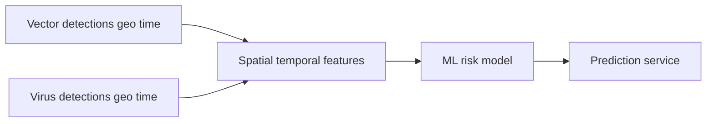

# Vector Guard

Predict geographic risk of vector-borne virus presence or outbreak from vector detections and related spatial-temporal context.

## Problem description

Vector-borne diseases (for example dengue, West Nile fever, Zika, or chikungunya) spread when competent vectors—such as mosquitoes or ticks—are present and environmental and ecological conditions allow transmission. As vectors expand into new areas and climate and land use change, public-health agencies need ways to prioritize surveillance and control before outbreaks become large.

Existing tools often fall into two categories:

1. **Suitability / outbreak risk** — Can this place support transmission *if* the pathogen is present? This is relatively tractable with entomological, environmental, and epidemiological signals.
2. **Exact introduction timing** — *When* will the virus first arrive at a given location? That is highly stochastic: it depends on rare human mobility events (for example an infected traveler) and is much harder to predict reliably.

**Vector Guard** focuses on the first problem. The project estimates a **risk score** (probability of suitability or outbreak risk) for geographic locations, including places where virus reports are sparse or absent, by relating vector presence patterns to virus detection patterns over space and time.

### How the solution will be used

The intended output is an **early-warning / prioritization aid** for surveillance and control planning:

- Flag locations with high estimated risk given observed vector activity
- Help compare relative risk across regions or time windows
- Support decisions on where to intensify trapping, testing, or outreach

It is **not** a clinical diagnostic tool and does not replace expert epidemiological judgment. Exact first-introduction dates are out of scope; the model targets risk of conditions that favor virus presence or outbreak potential.

## Intended approach



1. **Build two datasets** (vector source selected; virus still TBD — see [Data](#data)):
   - **Vector detections** — taxon/species, geographic location, detection time
   - **Virus detections** — pathogen, geographic location, detection time
2. **Join and aggregate** records to a common geographic-temporal unit (for example grid cells or administrative areas × time windows).
3. **EDA** — missing values, spatial and temporal coverage, target distribution, and feature importance.
4. **Model selection** — train multiple models (linear and tree-based), tune hyperparameters, and select the best performer.
5. **Deploy** — export training to a script, serve the final model via a web API, and run it locally in Docker (cloud deployment optional).

## Data

### Vector detections — VectorNet (selected)

| Field | Value |
|-------|-------|
| Dataset | [VectorNet](https://ipt.gbif.org/resource?r=vndatabase) (ECDC / EFSA) |
| GBIF UUID | `e497586a-1bdf-4f69-90eb-645d615762c8` |
| Format | Darwin Core Archive (DwC-A) |
| Latest download URL | `https://ipt.gbif.org/archive.do?r=vndatabase` |
| License | [CC-BY 4.0](https://creativecommons.org/licenses/by/4.0/) |
| Local path | `data/raw/vector/` (not committed; re-fetched on demand) |

Refresh the local raw copy (wipes and replaces `data/raw/vector/`):

```bash
jupyter notebook notebooks/01_extract_vectors.ipynb
```

Then run all cells. The notebook writes `manifest.json` (fetch time, URL, SHA-256) next to the extracted archive.

Downstream notebooks load the table with the shared helper:

```python
from vector_guard.data import load_vector_detections

df = load_vector_detections()
```

### Virus detections

**Still pending.** Candidate leads are noted under [`docs/`](docs/) (surveillance portals, sequence metadata repositories, and related background).

## Roadmap

See [`ROADMAP.md`](ROADMAP.md) for the planned features and build order (data, EDA, models, training script, API, environment, Docker, and optional cloud deploy).

## Planned project structure

| Path | Role |
|------|------|
| `src/vector_guard/` | Shared helpers (e.g. `load_vector_detections`) used by notebooks |
| `notebooks/01_extract_vectors.ipynb` | Download latest VectorNet DwC-A and overwrite `data/raw/vector/` |
| `notebooks/02_eda_vectors.ipynb` | Exploratory analysis of the vector detections dataset |
| `notebook.ipynb` | Model comparison and tuning (after EDA) |
| `train.py` | Train the final model and save it to disk |
| `predict.py` | Load the model and serve predictions via a web service |
| Dependency file (`requirements.txt`, `Pipfile`, or `pyproject.toml`) | Environment and package versions |
| `Dockerfile` | Container image for the prediction service |
| `docs/` | Research notes and working documentation |

## Setup

*Coming soon* — install dependencies and activate the virtual environment once the stack is finalized.

## Model training

*Coming soon* — how to run the notebook and `train.py`, including expected outputs (saved model artifact).

## Deployment

*Coming soon* — how to build and run the Docker image locally, example API requests, and (optionally) cloud or Kubernetes deployment notes with a test URL or screenshot.

## Reproducibility

*Coming soon* — steps to re-run the notebook and training script end-to-end once datasets and download instructions are published.
