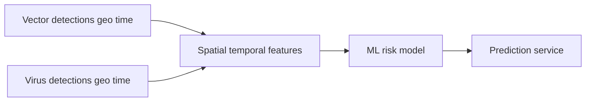

# Vector Guard

Predict **pathogen-specific** geographic risk from observed vector activity (ideally at species/genus resolution): given vectors here, how likely is pathogen X soon?

## Problem statement

Vector-borne diseases (for example dengue, West Nile fever, Zika, or chikungunya) spread when competent vectors—such as mosquitoes or ticks—are present and environmental and ecological conditions allow transmission. The same vector group can transmit several pathogens, so prioritization needs **which** pathogen is at risk—not only whether any virus in that ecological group might appear.

Existing tools often fall into two categories:

1. **Suitability / outbreak risk** — Can this place support transmission of a given pathogen *if* introduction occurs? This is relatively tractable with entomological, environmental, and epidemiological signals.
2. **Exact introduction timing** — *When* will a pathogen first arrive at a given location? That is highly stochastic: it depends on rare human mobility events (for example an infected traveler) and is much harder to predict reliably.

**Vector Guard** focuses on the first problem. The project estimates a **pathogen-specific risk score** for geographic locations by relating vector presence patterns (group aggregates, richness, and late-pivoted priority species/genus counts) to detection patterns of each target pathogen over space and time.

### How the solution will be used

The intended output is an **early-warning / prioritization aid** for surveillance and control planning:

- Flag locations with high estimated risk for a **named pathogen** given observed vector activity
- Help compare relative risk across pathogens, regions, or time windows
- Support decisions on where to intensify trapping, testing, or outreach

### Project layout

Organize the repository as a **generic ML project**:

1. **Root surface** — this README, training script, prediction service, container, dependency file.
2. **Upstream dataset construction** — when inputs are not a single ready table, build the modelling dataset under `notebooks/01_sources/` into `data/03_processed/`.
3. **Staged data** — `data/01_raw/` → `data/02_interim/` → `data/03_processed/`, plus `data/external/` for lookups.
4. **Staged notebooks** — `01_sources` (dataset construction), `02_eda` (EDA), `03_features` (prep / feature handoff), `04_modeling` (train / tune / compare).

```text
vector-guard/
├── README.md
├── train.py
├── predict.py
├── Dockerfile
├── pyproject.toml
├── data/
│   ├── 01_raw/
│   ├── 02_interim/
│   ├── 03_processed/
│   └── external/
├── notebooks/
│   ├── 01_sources/
│   ├── 02_eda/
│   ├── 03_features/
│   └── 04_modeling/
├── src/vector_guard/
├── specs/
└── deploy/
```

### Deliverable areas → location

| Deliverable area | Where |
|------------------|-------|
| Problem description | This README § [Problem statement](#problem-statement) |
| EDA | [`notebooks/02_eda/`](notebooks/02_eda/) — runbook [`notebooks/02_eda/README.md`](notebooks/02_eda/README.md) |
| Feature prep / modelling handoff | [`notebooks/03_features/`](notebooks/03_features/) — runbook [`notebooks/03_features/README.md`](notebooks/03_features/README.md) |
| Model training | [`notebooks/04_modeling/`](notebooks/04_modeling/) — runbook [`notebooks/04_modeling/README.md`](notebooks/04_modeling/README.md) |
| Exporting notebook to script | [`train.py`](train.py) |
| Reproducibility | [`data/`](data/) + [Dataset description](#dataset-description); rebuild via [`notebooks/01_sources/README.md`](notebooks/01_sources/README.md) |
| Model deployment | [`predict.py`](predict.py) |
| Dependency and environment management | [`pyproject.toml`](pyproject.toml) + [`uv.lock`](uv.lock) + [How to run](#how-to-run-locally-and-via-docker) |
| Containerization | [`Dockerfile`](Dockerfile) + [How to run](#how-to-run-locally-and-via-docker) |
| Cloud deployment | [`deploy/`](deploy/) + [How to run](#how-to-run-locally-and-via-docker) (optional) |

Dataset construction under `notebooks/01_sources/` maps to **Reproducibility** / Data. It is **not** the EDA deliverable area.

## Dataset description

The modelling handoff is a pathogen-long panel plus a long species composition table:

| Item | Path |
|------|------|
| Panel | [`data/03_processed/modelling_panel.parquet`](data/03_processed/) |
| Species (long) | [`data/03_processed/modelling_panel_species.parquet`](data/03_processed/) |
| Vectors species-monthly | [`data/03_processed/vectors_species_monthly.parquet`](data/03_processed/) |
| Manifest | `data/03_processed/modelling_panel_manifest.json` |

Panel grain, labels, species side table, vectors species-monthly, and coverage contract: [`specs/04-reference-data-and-panel-pipeline.md`](specs/04-reference-data-and-panel-pipeline.md). Pathogen ↔ `vector_group` taxonomy: [`specs/02-virus-dataset-selection.md`](specs/02-virus-dataset-selection.md) § [Target virus taxonomy](specs/02-virus-dataset-selection.md#target-virus-taxonomy) (code: `VIRUS_VECTOR_TAXON_MAP`; mirror CSV `data/external/pathogen_vector_group.csv`). Vector sources: [`specs/01-vector-dataset-selection.md`](specs/01-vector-dataset-selection.md).

Load it in a notebook (same pattern as notebooks under [`02_eda`](notebooks/02_eda/) / [`03_features`](notebooks/03_features/)):

```python
from pathlib import Path
import pandas as pd
from vector_guard.data import default_processed_dir, find_repo_root

REPO_ROOT = find_repo_root(Path.cwd())
PROCESSED = default_processed_dir(REPO_ROOT)
panel = pd.read_parquet(PROCESSED / "modelling_panel.parquet")
species = pd.read_parquet(PROCESSED / "modelling_panel_species.parquet")
```

To regenerate the panel / species table or read how they were designed, see [`notebooks/01_sources/README.md`](notebooks/01_sources/README.md) (links to specs `01`–`04`).

## Architecture

Placeholder sketch — refine later as the API and feature pipeline solidify.



```text
data/03_processed/modelling_panel.parquet
data/03_processed/modelling_panel_species.parquet
  → notebooks/02_eda → notebooks/03_features → notebooks/04_modeling
  → train.py → predict.py → Docker
```

## EDA summary

Primary EDA lives under [`notebooks/02_eda/`](notebooks/02_eda/) on the modelling panel + species side table (missingness, coverage, target, spatial/temporal plots). Locked late priority species pivot and the modelling feature handoff live under [`notebooks/03_features/`](notebooks/03_features/). Source-inspect notebooks under `notebooks/01_sources/` are construction QA only.

*Coming soon* — short findings once distribution, target, and importance analyses are complete.

## Modeling approach & metrics

Train multiple models (linear and tree-based), tune hyperparameters, and select the best performer under [`notebooks/04_modeling/`](notebooks/04_modeling/); export the final fit via [`train.py`](train.py).

*Coming soon* — chosen models, metrics (e.g. ROC-AUC / PR-AUC / calibration), and comparison results.

## How to run locally and via Docker

*Coming soon* — install dependencies (`pyproject.toml` / `uv.lock`), run stage notebooks and `train.py`, and build/run the Docker image for the prediction service.

Until then: rebuild the panel via [`notebooks/01_sources/README.md`](notebooks/01_sources/README.md), then continue with [`notebooks/02_eda/README.md`](notebooks/02_eda/README.md) → [`03_features`](notebooks/03_features/README.md) → [`04_modeling`](notebooks/04_modeling/README.md).

## API usage example

[`predict.py`](predict.py) will serve predictions from the saved model.

*Coming soon* — example request/response once the API shape is fixed. Sketch:

```bash
# Placeholder — endpoint and payload TBD
curl -X POST http://localhost:8000/predict \
  -H "Content-Type: application/json" \
  -d '{"h3_cell": "...", "year": 2023, "month": 7, "vector_group": "mosquito", "pathogen_name": "West Nile virus"}'
```

## Known limitations / next steps

- Not a clinical diagnostic; does not replace expert epidemiological judgment.
- Exact first-introduction timing is out of scope.
- Virus detections are not classified as local vs imported; travel-related cases may appear as place-time positives (deferred label-quality work in [`ROADMAP.md`](ROADMAP.md) / [`specs/02`](specs/02-virus-dataset-selection.md)).
- Pathogen zeros mean no report of **that** pathogen in the merged feeds for that unit-window, not proof of absence.

See [`ROADMAP.md`](ROADMAP.md) for planned features and build order.
