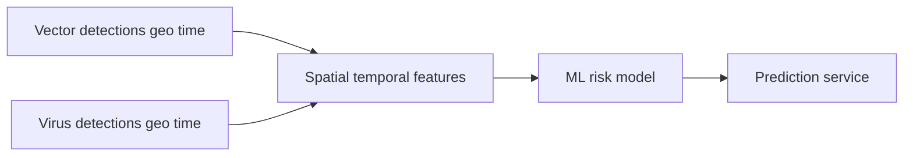

# Vector Guard

Predict geographic risk of vector-borne virus presence or outbreak from vector detections and related spatial-temporal context.

## Problem statement

Vector-borne diseases (for example dengue, West Nile fever, Zika, or chikungunya) spread when competent vectors—such as mosquitoes or ticks—are present and environmental and ecological conditions allow transmission. As vectors expand into new areas and climate and land use change, public-health agencies need ways to prioritize surveillance and control before outbreaks become large.

Existing tools often fall into two categories:

1. **Suitability / outbreak risk** — Can this place support transmission *if* the pathogen is present? This is relatively tractable with entomological, environmental, and epidemiological signals.
2. **Exact introduction timing** — *When* will the virus first arrive at a given location? That is highly stochastic: it depends on rare human mobility events (for example an infected traveler) and is much harder to predict reliably.

**Vector Guard** focuses on the first problem. The project estimates a **risk score** (probability of suitability or outbreak risk) for geographic locations, including places where virus reports are sparse or absent, by relating vector presence patterns to virus detection patterns over space and time.

### How the solution will be used

The intended output is an **early-warning / prioritization aid** for surveillance and control planning:

- Flag locations with high estimated risk given observed vector activity
- Help compare relative risk across regions or time windows
- Support decisions on where to intensify trapping, testing, or outreach

### Project layout

Organize the repository as a **generic ML project**:

1. **Root surface** — this README, primary analysis notebook, training script, prediction service, container, dependency file.
2. **Upstream dataset construction** — when inputs are not a single ready table, build the modelling dataset under `notebooks/01_sources/` into `data/03_processed/`.
3. **Staged data** — `data/01_raw/` → `data/02_interim/` → `data/03_processed/`, plus `data/external/` for lookups.
4. **Staged notebooks** — `01_sources`, `02_eda`, `03_features`, `04_modeling`; primary EDA and modeling remain in root `notebook.ipynb`.

```text
vector-guard/
├── README.md
├── notebook.ipynb
├── train.py
├── predict.py
├── Dockerfile
├── pyproject.toml
├── data/
│   ├── 01_raw/
│   ├── 02_interim/
│   ├── 03_processed/
│   └── external/
├── notebooks/
│   ├── 01_sources/
│   ├── 02_eda/
│   ├── 03_features/
│   └── 04_modeling/
├── src/vector_guard/
├── specs/
└── deploy/
```

### Deliverable areas → location

| Deliverable area | Where |
|------------------|-------|
| Problem description | This README § [Problem statement](#problem-statement) |
| EDA | [`notebook.ipynb`](notebook.ipynb) only |
| Model training | [`notebook.ipynb`](notebook.ipynb) |
| Exporting notebook to script | [`train.py`](train.py) |
| Reproducibility | [`data/`](data/) + [Dataset description](#dataset-description); rebuild via [`notebooks/01_sources/README.md`](notebooks/01_sources/README.md) |
| Model deployment | [`predict.py`](predict.py) |
| Dependency and environment management | [`pyproject.toml`](pyproject.toml) + [`uv.lock`](uv.lock) + [How to run](#how-to-run-locally-and-via-docker) |
| Containerization | [`Dockerfile`](Dockerfile) + [How to run](#how-to-run-locally-and-via-docker) |
| Cloud deployment | [`deploy/`](deploy/) + [How to run](#how-to-run-locally-and-via-docker) (optional) |

Dataset construction under `notebooks/01_sources/` maps to **Reproducibility** / Data. It is **not** the EDA deliverable area.

## Dataset description

The modelling handoff is a single panel:

| Item | Path |
|------|------|
| Panel | [`data/03_processed/modelling_panel.parquet`](data/03_processed/) |
| Manifest | `data/03_processed/modelling_panel_manifest.json` |

**Grain:** Tier 1 `(h3_cell, year, month, vector_group)`; Tier 2 `(country_iso2, year, month, vector_group)`. **Target:** `virus_detected` (binary). Supervised rows require VectorNet coverage.

Load it in a notebook (same pattern as root [`notebook.ipynb`](notebook.ipynb)):

```python
from pathlib import Path
import pandas as pd
from vector_guard.data import default_processed_dir, find_repo_root

REPO_ROOT = find_repo_root(Path.cwd())
PANEL_PATH = default_processed_dir(REPO_ROOT) / "modelling_panel.parquet"
panel = pd.read_parquet(PANEL_PATH)
```

To regenerate the panel or read how it was designed, see [`notebooks/01_sources/README.md`](notebooks/01_sources/README.md) (links to specs `01`–`04`).

## Architecture

Placeholder sketch — refine later as the API and feature pipeline solidify.



```text
data/03_processed/modelling_panel.parquet  →  notebook.ipynb / train.py  →  predict.py  →  Docker
```

## EDA summary

Primary EDA lives in [`notebook.ipynb`](notebook.ipynb) on the modelling panel (missingness, coverage, target, feature importance). Source-inspect notebooks under `notebooks/01_sources/` are construction QA only.

*Coming soon* — short findings once distribution, target, and importance analyses are complete.

## Modeling approach & metrics

Train multiple models (linear and tree-based), tune hyperparameters, and select the best performer in [`notebook.ipynb`](notebook.ipynb); export the final fit via [`train.py`](train.py).

*Coming soon* — chosen models, metrics (e.g. ROC-AUC / PR-AUC / calibration), and comparison results.

## How to run locally and via Docker

*Coming soon* — install dependencies (`pyproject.toml` / `uv.lock`), run `notebook.ipynb` and `train.py`, and build/run the Docker image for the prediction service.

Until then: rebuild the panel via [`notebooks/01_sources/README.md`](notebooks/01_sources/README.md), then open [`notebook.ipynb`](notebook.ipynb).

## API usage example

[`predict.py`](predict.py) will serve predictions from the saved model.

*Coming soon* — example request/response once the API shape is fixed. Sketch:

```bash
# Placeholder — endpoint and payload TBD
curl -X POST http://localhost:8000/predict \
  -H "Content-Type: application/json" \
  -d '{"h3_cell": "...", "year": 2023, "month": 7, "vector_group": "mosquito"}'
```

## Known limitations / next steps

- Not a clinical diagnostic; does not replace expert epidemiological judgment.
- Exact first-introduction timing is out of scope.
- Virus zeros mean no report in the merged feeds for that unit-window, not proof of absence.

See [`ROADMAP.md`](ROADMAP.md) for planned features and build order.
