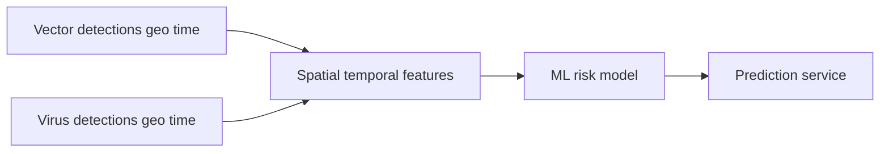

# Vector Guard

Predict geographic risk of vector-borne virus presence or outbreak from vector detections and related spatial-temporal context.

## Problem description

Vector-borne diseases (for example dengue, West Nile fever, Zika, or chikungunya) spread when competent vectors—such as mosquitoes or ticks—are present and environmental and ecological conditions allow transmission. As vectors expand into new areas and climate and land use change, public-health agencies need ways to prioritize surveillance and control before outbreaks become large.

Existing tools often fall into two categories:

1. **Suitability / outbreak risk** — Can this place support transmission *if* the pathogen is present? This is relatively tractable with entomological, environmental, and epidemiological signals.
2. **Exact introduction timing** — *When* will the virus first arrive at a given location? That is highly stochastic: it depends on rare human mobility events (for example an infected traveler) and is much harder to predict reliably.

**Vector Guard** focuses on the first problem. The project estimates a **risk score** (probability of suitability or outbreak risk) for geographic locations, including places where virus reports are sparse or absent, by relating vector presence patterns to virus detection patterns over space and time.

### How the solution will be used

The intended output is an **early-warning / prioritization aid** for surveillance and control planning:

- Flag locations with high estimated risk given observed vector activity
- Help compare relative risk across regions or time windows
- Support decisions on where to intensify trapping, testing, or outreach

It is **not** a clinical diagnostic tool and does not replace expert epidemiological judgment. Exact first-introduction dates are out of scope; the model targets risk of conditions that favor virus presence or outbreak potential.

## Dataset construction vs modelling flow

Many ML projects start from a single ready modelling table. This repository builds that table first from multiple sources (vector + virus extracts, lookups, clean, merge) under [`notebooks/01_sources/`](notebooks/01_sources/). The handoff is [`data/03_processed/`](data/03_processed/) (modelling panel).

**EDA and model training** in the Evaluation Criteria below apply to analysis of that panel in root [`notebook.ipynb`](notebook.ipynb)—not to source-inspect notebooks under `01_sources/`.

```text
notebooks/01_sources/  →  data/03_processed/modelling_panel.*  →  notebook.ipynb → train.py → predict.py → Docker
```

## Evaluation Criteria

| Criterion | Where in this repo |
|-----------|--------------------|
| Problem description | This README § [Problem description](#problem-description) |
| EDA | [`notebook.ipynb`](notebook.ipynb) only (on the modelling panel) |
| Model training | [`notebook.ipynb`](notebook.ipynb) |
| Exporting notebook to script | [`train.py`](train.py) |
| Reproducibility | [`data/`](data/) + [Data](#data) / [Setup](#setup); rebuild via [`notebooks/01_sources/`](notebooks/01_sources/) |
| Model deployment | [`predict.py`](predict.py) |
| Dependency and environment management | [`pyproject.toml`](pyproject.toml) + [`uv.lock`](uv.lock) + [Setup](#setup) |
| Containerization | [`Dockerfile`](Dockerfile) + [Deployment](#deployment) |
| Cloud deployment | [`deploy/`](deploy/) + [Deployment](#deployment) (optional) |

`notebooks/01_sources/**` supports **Reproducibility** / Data. It is not the EDA deliverable.

## Intended approach



1. **Build two datasets** (sources selected — see [Data](#data)):
   - **Vector detections** — taxon/species, geographic location, detection time (VectorNet)
   - **Virus detections** — pathogen, geographic location, detection time (multi-source extract: ENA, BV-BRC, Pathoplexus, EMPRES-i, ECDC)
2. **Resolve and join** onto common keys using external lookups (ISO-2 countries, subnational / NUTS3 centroids, vector_group maps). Tier 1 uses Uber H3 from exact GPS **or** curated admin centroids; Tier 2 falls back to ISO-2 country. Temporal grain **`year` × `month`** — see [`specs/03-spatial-temporal-matching-strategy.md`](specs/03-spatial-temporal-matching-strategy.md) and [`specs/04-reference-data-and-panel-pipeline.md`](specs/04-reference-data-and-panel-pipeline.md).
3. **Merge** cleaned sides into one modelling panel under `data/03_processed/` (training units require VectorNet coverage).
4. **EDA** — missing values, spatial and temporal coverage, target distribution, and feature importance (on the panel in `notebook.ipynb`).
5. **Model selection** — train multiple models (linear and tree-based), tune hyperparameters, and select the best performer.
6. **Deploy** — export training to a script, serve the final model via a web API, and run it locally in Docker (cloud deployment optional).

## Data

Decision records for source selection, join design, and the panel pipeline live under [`specs/`](specs/):

| Spec | Topic |
|------|-------|
| [`specs/01-vector-dataset-selection.md`](specs/01-vector-dataset-selection.md) | VectorNet DwC-A selection and discarded alternatives |
| [`specs/02-virus-dataset-selection.md`](specs/02-virus-dataset-selection.md) | Multi-source virus strategy, unified schema, expanded taxonomy |
| [`specs/03-spatial-temporal-matching-strategy.md`](specs/03-spatial-temporal-matching-strategy.md) | H3 Tier 1 (GPS or subnational centroids) + ISO-2 Tier 2 |
| [`specs/04-reference-data-and-panel-pipeline.md`](specs/04-reference-data-and-panel-pipeline.md) | External lookups (incl. subnational centroids), resolve steps, merge → modelling panel ([Panel columns](specs/04-reference-data-and-panel-pipeline.md#panel-columns) dictionary) |
| [`specs/05-project-layout.md`](specs/05-project-layout.md) | Project layout and Evaluation Criteria map |

Data layout (ladder):

| Path | Role |
|------|------|
| `data/01_raw/` | Source extracts (VectorNet, multi-source virus TSV); not committed; refresh via `notebooks/01_sources/` |
| `data/external/` | Lookup tables (`countries.csv`, `subnational_locations.csv`, `vector_taxon_groups.csv`); committed |
| `data/02_interim/` | Normalized per-side detection tables after cleaning |
| `data/03_processed/` | Merged **modelling panel** used by `notebook.ipynb` / `train.py` |

H3 cell IDs are computed from lat/lon (exact GPS or curated subnational / NUTS3 centroids) at **`H3_RESOLUTION=4`** (chosen in `notebooks/01_sources/07_h3_resolution_density.ipynb`; not a downloaded world H3 dump).

To locate an `h3_cell` value on a map manually, paste the cell ID into the [H3 Viewer](https://clupasq.github.io/h3-viewer/).

### Vector detections — VectorNet observations (selected)

| Field | Value |
|-------|-------|
| Dataset | [VectorNet observations](https://www.gbif.org/dataset/4abd984b-122c-44a0-8c92-b37e2f5299b1) (ECDC / EFSA) |
| GBIF UUID | `4abd984b-122c-44a0-8c92-b37e2f5299b1` |
| Format | Darwin Core Archive (DwC-A) |
| Latest download URL | `https://www.gbif.se/ipt/archive.do?r=vectornet_historical_data` |
| License | [CC-BY 4.0](https://creativecommons.org/licenses/by/4.0/) |
| Local path | `data/01_raw/vector/` (not committed; re-fetched on demand) |
| Decision | [`specs/01-vector-dataset-selection.md`](specs/01-vector-dataset-selection.md) |

Refresh the local raw copy (wipes and replaces `data/01_raw/vector/`):

```bash
jupyter notebook notebooks/01_sources/01_extract_vectors.ipynb
```

Then run all cells. The notebook writes `manifest.json` (fetch time, URL, SHA-256) next to the extracted archive.

Downstream notebooks load the table with the shared helper:

```python
from vector_guard.data import load_vector_detections

df = load_vector_detections()
```

### Virus detections — multi-source extract (implemented)

| Field | Value |
|-------|-------|
| Strategy | Unified multi-source extract into `virus_detections.tsv` — see [`specs/02-virus-dataset-selection.md`](specs/02-virus-dataset-selection.md) |
| Feeds | [ENA Portal](https://www.ebi.ac.uk/ena/portal/api/) `sequence` + `read_run` + `sample` backfill; [BV-BRC Genome API](https://www.bv-brc.org/api/genome/); [Pathoplexus LAPIS](https://lapis.pathoplexus.org/); FAO EMPRES-i BigQuery CSV; ECDC WNV weekly/monthly NUTS3 |
| Format | Unified 19-column TSV metadata extract |
| Local path | `data/01_raw/virus/` (not committed; re-fetched on demand) |
| Decision | [`specs/02-virus-dataset-selection.md`](specs/02-virus-dataset-selection.md) |

**Taxonomy:** twenty-six vector-borne pathogens (mosquito-, tick-, biting-midge-, and sandfly-borne), tagged with `pathogen_name` and `vector_group`. Live-verified NCBI / ICTV tax IDs live in [`src/vector_guard/data.py`](src/vector_guard/data.py) (`VIRUS_VECTOR_TAXON_MAP`).

Refresh the local raw copy (wipes and replaces `data/01_raw/virus/`):

```bash
jupyter notebook notebooks/01_sources/03_extract_viruses.ipynb
```

Then run all cells. The notebook writes the unified `virus_detections.tsv` and `manifest.json` (fetch time, per-source and per-pathogen counts, SHA-256, citations, `coord_source_counts`).

Downstream notebooks load the table with the shared helper:

```python
from vector_guard.data import load_virus_detections

df = load_virus_detections()
```

Source inspection (dataset construction QA): [`notebooks/01_sources/04_inspect_viruses.ipynb`](notebooks/01_sources/04_inspect_viruses.ipynb).

## Roadmap

See [`ROADMAP.md`](ROADMAP.md) for the planned features and build order (data, EDA, models, training script, API, environment, Docker, and optional cloud deploy).

## Project structure

| Path | Role |
|------|------|
| `notebook.ipynb` | Primary notebook: EDA + model selection + tuning (from modelling panel) |
| `train.py` | Train the final model and save it to disk |
| `predict.py` | Load the model and serve predictions via a web service |
| `Dockerfile` | Container image for the prediction service |
| `pyproject.toml` / `uv.lock` | Environment and package versions |
| `data/01_raw/` | Original downloads (gitignored extracts) |
| `data/02_interim/` | Intermediate normalized tables |
| `data/03_processed/` | Modelling panel handoff |
| `data/external/` | Lookup / dictionary CSVs (committed) |
| `notebooks/01_sources/` | Upstream: extract, inspect, clean, merge → modelling panel |
| `notebooks/02_eda/` | Optional EDA drafts (primary EDA is root `notebook.ipynb`) |
| `notebooks/03_features/` | Feature engineering drafts |
| `notebooks/04_modeling/` | Model experiment drafts |
| `src/vector_guard/` | Shared helpers (`load_vector_detections`, `load_virus_detections`, resolve, extract) |
| `specs/` | Decision records (dataset selection, matching, panel pipeline, layout) |
| `deploy/` | Optional cloud / cluster deployment |

## Setup

*Coming soon* — install dependencies and activate the virtual environment once the stack is finalized.

## Model training

*Coming soon* — how to run the notebook and `train.py`, including expected outputs (saved model artifact).

## Deployment

*Coming soon* — how to build and run the Docker image locally, example API requests, and (optionally) cloud or Kubernetes deployment notes with a test URL or screenshot.

## Reproducibility

*Coming soon* — steps to re-run dataset construction (`notebooks/01_sources/`), the primary notebook, and the training script end-to-end.
