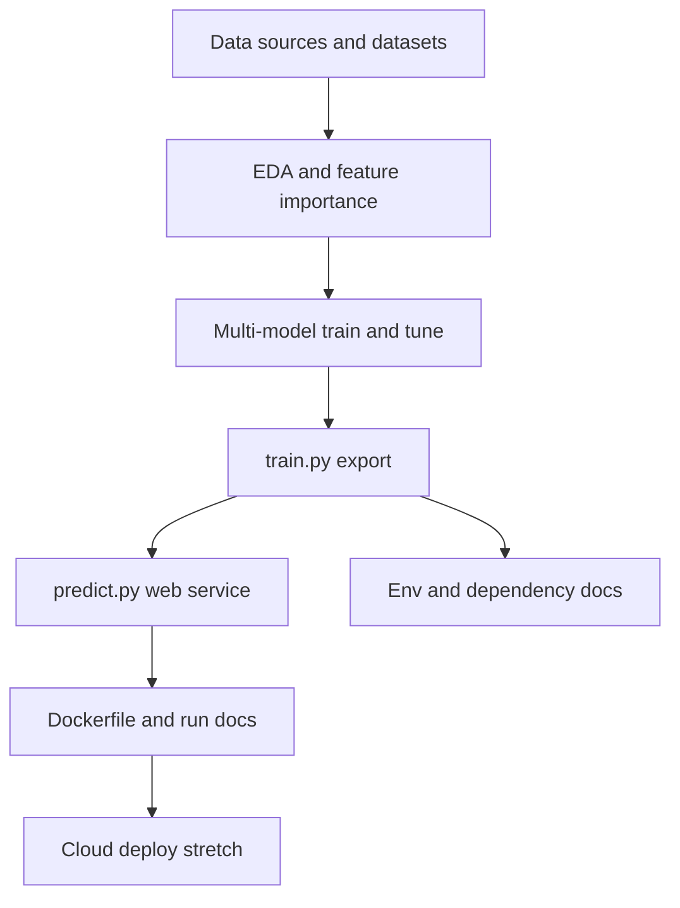

# Vector Guard roadmap

Feature and deliverable plan. Items are ordered for a practical build sequence. Decisions live in [`specs/`](specs/); this file tracks **status** only. Layout and deliverable → path map: [`README.md`](README.md).

| Status | Meaning |
|--------|---------|
| Done | Implemented |
| Next | Immediate priority |
| Planned | Scheduled after Next |
| Later | Optional / stretch |

---

## 1. Problem description and documentation

**Deliverable area:** Problem description (complete when README has enough context on the problem and how the solution is used).

| Feature / deliverable | Status | Notes |
|-----------------------|--------|-------|
| README problem statement and intended use | Done | [`README.md`](README.md) |
| Run instructions for setup, train, predict, Docker | Planned | Fill README stub as components land |
| Link data download / inclusion instructions in README | Done | [`README.md`](README.md); rebuild runbook [`notebooks/01_sources/README.md`](notebooks/01_sources/README.md) |

---

## 2. Data foundation

**Deliverable area:** Reproducibility (data committed or clearly downloadable); feeds EDA and training.

| Feature / deliverable | Status | Notes |
|-----------------------|--------|-------|
| Select and document vector detection source(s) | Done | [`specs/01`](specs/01-vector-dataset-selection.md) |
| Select and document virus detection source(s) | Done | [`specs/02`](specs/02-virus-dataset-selection.md) |
| Document spatial join (H3 + subnational centroids) | Done | [`specs/03`](specs/03-spatial-temporal-matching-strategy.md) |
| Document reference data + panel pipeline | Done | [`specs/04`](specs/04-reference-data-and-panel-pipeline.md) |
| Build vector dataset (geo + time) | Done | Notebook `08` → interim; see [`specs/04`](specs/04-reference-data-and-panel-pipeline.md) |
| Upgrade virus raw extract (multi-source + taxonomy) | Done | Notebook `03`; see [`specs/02`](specs/02-virus-dataset-selection.md) |
| Build virus dataset (geo + time, clean) | Done | Notebook `09` → interim; see [`specs/04`](specs/04-reference-data-and-panel-pipeline.md) |
| Build reference data (countries, subnational centroids, vector taxon groups) | Done | Notebooks `05`–`06`; see [`specs/04`](specs/04-reference-data-and-panel-pipeline.md) |
| Choose H3 resolution (density check) | Done | Notebook `07`; `H3_RESOLUTION=4` — [`specs/04`](specs/04-reference-data-and-panel-pipeline.md) |
| Merge modelling panel (vector + virus) | Done | Notebook `10` → `data/03_processed/`; see [`specs/04`](specs/04-reference-data-and-panel-pipeline.md) |
| Commit data or publish reproducible download steps | Done | Rebuild: [`notebooks/01_sources/README.md`](notebooks/01_sources/README.md) |
| Distinguish local vs imported virus detections | Later | Label quality: filter/down-weight travel-related cases so they do not imply an established local cycle; see [`specs/02`](specs/02-virus-dataset-selection.md) § Candidates for future additions |

---

## 3. Exploratory data analysis

**Deliverable area:** EDA (complete when: ranges, missing values, target analysis, feature importance).

| Feature / deliverable | Status | Notes |
|-----------------------|--------|-------|
| Initial vector / virus source inspect notebooks | Done | Construction QA in `01_sources` (`02`, `04`); not the EDA deliverable |
| Data cleaning and preparation in `notebook.ipynb` | Done | Panel load + prep handoff in root notebook |
| Distribution and range analysis of features | Next | Including spatial/temporal coverage |
| Target variable analysis (risk / suitability label) | Planned | Class balance, risk-score target definition |
| Feature importance analysis | Planned | |
| Spatial / temporal exploratory plots | Planned | |

---

## 4. Model training and selection

**Deliverable area:** Model training (complete when: multiple models **and** hyperparameter tuning).

| Feature / deliverable | Status | Notes |
|-----------------------|--------|-------|
| Baseline linear model (e.g. logistic regression) | Planned | |
| Tree-based model(s) (e.g. Random Forest, XGBoost) | Planned | At least one linear + one tree-based |
| Hyperparameter tuning for candidate models | Planned | |
| Model comparison metrics documented in notebook | Planned | e.g. ROC-AUC, PR-AUC, calibration |
| Persist final model artifact | Planned | |

---

## 5. Training script export

**Deliverable area:** Exporting notebook to script.

| Feature / deliverable | Status | Notes |
|-----------------------|--------|-------|
| `train.py` — train final model end-to-end | Planned | |
| `train.py` — save model (and preprocessing) to disk | Planned | |

---

## 6. Prediction service

**Deliverable area:** Model deployment (web service with Flask, FastAPI, BentoML, or similar).

| Feature / deliverable | Status | Notes |
|-----------------------|--------|-------|
| `predict.py` — load model and preprocessing | Planned | |
| HTTP API endpoint for risk score prediction | Planned | |
| Example request documented in README | Planned | |

---

## 7. Environment and dependencies

**Deliverable area:** Dependency and environment management (complete when: dependency file + virtual env + README install/activate steps).

| Feature / deliverable | Status | Notes |
|-----------------------|--------|-------|
| Locked dependency file (`pyproject.toml` + `uv.lock`) | Done | Files present; keep authoritative |
| Documented virtual environment create / activate / install | Planned | README How to run stub |
| Pin versions for reproducible installs | Done | Via `uv.lock` |

---

## 8. Containerization

**Deliverable area:** Containerization (complete when: Dockerfile **and** README build/run instructions).

| Feature / deliverable | Status | Notes |
|-----------------------|--------|-------|
| `Dockerfile` for the prediction service | Planned | |
| README: build image and run container | Planned | |
| Smoke-test containerized API | Planned | |

---

## 9. Cloud / cluster deployment (stretch)

**Deliverable area:** Cloud deployment (complete when: deploy code + live URL or demo video/screenshot).

| Feature / deliverable | Status | Notes |
|-----------------------|--------|-------|
| Deployment scripts or IaC for cloud / k8s | Later | |
| README deploy steps with concrete commands | Later | |
| Public test URL **or** video/screenshot of the live service | Later | |

---

## Suggested build order

Data foundation is **Done**. Next: deepen EDA on the panel, then models → `train.py` → API → env docs / Docker → optional cloud.

---

## Out of scope for this roadmap

- Clinical diagnosis or medical decision support
- Exact virus introduction *timing* (stochastic; not the modeling target)
