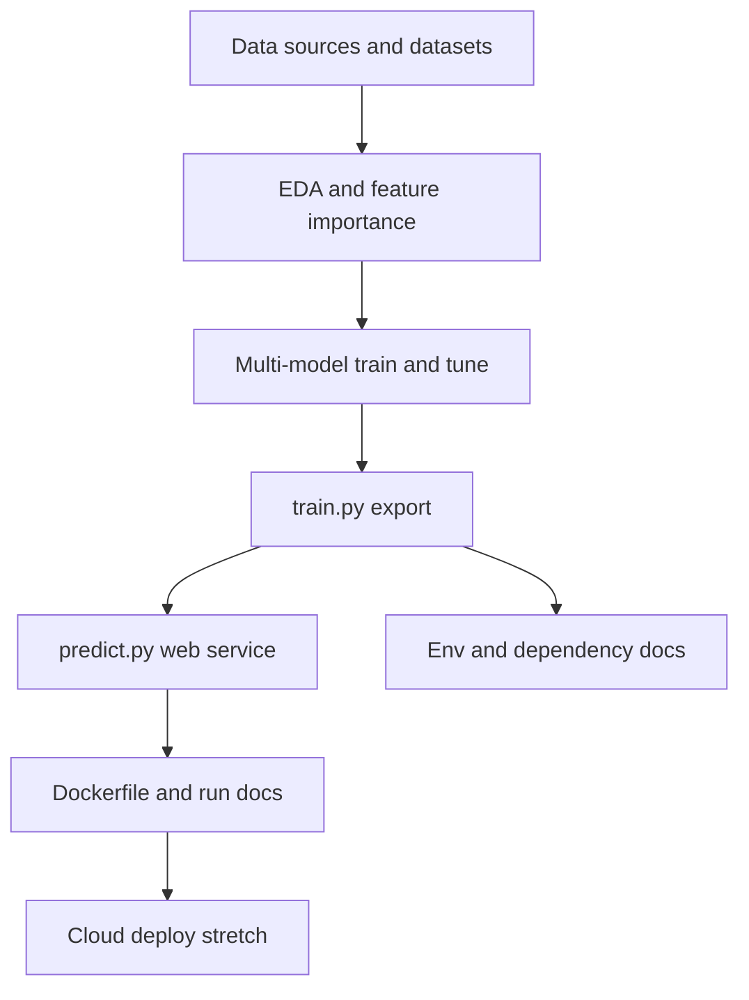

# Vector Guard roadmap

Feature and deliverable plan. Items are ordered for a practical build sequence.

| Status | Meaning |
|--------|---------|
| Done | Implemented |
| Next | Immediate priority |
| Planned | Scheduled after Next |
| Later | Optional / stretch |

---

## 1. Problem description and documentation

**Criteria:** Problem description (full credit when README has enough context on the problem and how the solution is used).

| Feature / deliverable | Status | Notes |
|-----------------------|--------|-------|
| README problem statement and intended use | Done | See [`README.md`](README.md) |
| Run instructions for setup, train, predict, Docker | Planned | Fill stub sections as components land |
| Link data download / inclusion instructions in README | Done | VectorNet + virus extract steps in [`README.md`](README.md); multi-source / subnational path in [`specs/`](specs/) |

---

## 2. Data foundation

**Criteria:** Reproducibility (data committed or clearly downloadable); feeds EDA and training.

| Feature / deliverable | Status | Notes |
|-----------------------|--------|-------|
| Select and document vector detection source(s) | Done | VectorNet observations DwC-A — [`specs/01-vector-dataset-selection.md`](specs/01-vector-dataset-selection.md) |
| Select and document virus detection source(s) | Done | Multi-source strategy decided (v1 ENA `sequence` implemented; upgrade Planned) — [`specs/02-virus-dataset-selection.md`](specs/02-virus-dataset-selection.md) |
| Document spatial join (H3 + subnational centroids) | Done | Path A GPS / Path B curated centroids → Tier 1; country Tier 2 — [`specs/03-spatial-temporal-matching-strategy.md`](specs/03-spatial-temporal-matching-strategy.md) |
| Document reference data + panel pipeline | Done | Countries, `subnational_locations.csv`, vector_group maps, coord priority ladder, H3 selection, merge contract — [`specs/04-reference-data-and-panel-pipeline.md`](specs/04-reference-data-and-panel-pipeline.md) |
| Build vector dataset (geo + time) | Planned | Raw extract Done via `01_extract_vectors.ipynb`; clean/normalize in planned `08_clean_vectors.ipynb` → `data/interim/` |
| Upgrade virus raw extract (multi-source + taxonomy) | Next | Expand `03_extract_viruses.ipynb` + `VIRUS_VECTOR_TAXON_MAP`: ENA `sequence` + `read_run`/`sample`, BV-BRC, Pathoplexus, EMPRES-i, ECDC; unified schema + per-source manifest — [`specs/02-virus-dataset-selection.md`](specs/02-virus-dataset-selection.md) |
| Build virus dataset (geo + time, clean) | Planned | After upgrade: `09_clean_viruses.ipynb` → `data/interim/` with ISO-2, coord ladder, `geo_precision`, H3 |
| Build reference data (countries, subnational centroids, vector taxon groups) | Done | `05_reference_countries.ipynb` → `countries.csv` + `subnational_locations.csv`; `06_reference_vector_groups.ipynb` → `vector_taxon_groups.csv` — [`specs/04-reference-data-and-panel-pipeline.md`](specs/04-reference-data-and-panel-pipeline.md) |
| Choose H3 resolution (density check) | Planned | Planned `07_h3_resolution_density.ipynb`; candidates res 4–5; compare exact-only vs exact+centroid; record chosen value in spec `04` |
| Merge modelling panel (vector + virus) | Planned | Planned `10_merge_modelling_panel.ipynb` → `data/processed/modelling_panel.*`; grain `year×month`; training units require VectorNet coverage — [`specs/03-spatial-temporal-matching-strategy.md`](specs/03-spatial-temporal-matching-strategy.md), [`specs/04-reference-data-and-panel-pipeline.md`](specs/04-reference-data-and-panel-pipeline.md) |
| Commit data or publish reproducible download steps | Done | Raw data gitignored; refresh notebooks documented in README; reference CSVs to be committed when built |

---

## 3. Exploratory data analysis

**Criteria:** EDA (full credit: ranges, missing values, target analysis, feature importance).

| Feature / deliverable | Status | Notes |
|-----------------------|--------|-------|
| Initial vector / virus EDA notebooks | Done | `02_eda_vectors.ipynb`, `04_eda_viruses.ipynb` (coverage / completeness first look); re-run / extend after multi-source virus upgrade |
| Data cleaning and preparation in `notebook.ipynb` | Planned | Missing values, outliers, geo/time filters |
| Distribution and range analysis of features | Planned | Including spatial/temporal coverage |
| Target variable analysis (risk / suitability label) | Planned | Class balance, definition of risk score target |
| Feature importance analysis | Planned | e.g. correlation, model-based importance |
| Spatial / temporal exploratory plots | Planned | Maps and time-series views of vector vs virus |

---

## 4. Model training and selection

**Criteria:** Model training (full credit: multiple models **and** hyperparameter tuning).

| Feature / deliverable | Status | Notes |
|-----------------------|--------|-------|
| Baseline linear model (e.g. logistic regression) | Planned | Interpretable risk probability baseline |
| Tree-based model(s) (e.g. Random Forest, XGBoost) | Planned | At least one linear + one tree-based |
| Hyperparameter tuning for candidate models | Planned | Cross-validation; select best model |
| Model comparison metrics documented in notebook | Planned | e.g. ROC-AUC, PR-AUC, calibration |
| Persist final model artifact | Planned | pickle / joblib / equivalent |

---

## 5. Training script export

**Criteria:** Exporting notebook to script.

| Feature / deliverable | Status | Notes |
|-----------------------|--------|-------|
| `train.py` — train final model end-to-end | Planned | Same pipeline as selected notebook model |
| `train.py` — save model (and preprocessing) to disk | Planned | Loadable by the prediction service |

---

## 6. Prediction service

**Criteria:** Model deployment (web service with Flask, FastAPI, BentoML, or similar).

| Feature / deliverable | Status | Notes |
|-----------------------|--------|-------|
| `predict.py` — load model and preprocessing | Planned | |
| HTTP API endpoint for risk score prediction | Planned | Input: location / features; output: risk probability |
| Example request documented in README | Planned | curl or similar |

---

## 7. Environment and dependencies

**Criteria:** Dependency and environment management (full credit: dependency file + virtual env + README install/activate steps).

| Feature / deliverable | Status | Notes |
|-----------------------|--------|-------|
| Locked dependency file (`pyproject.toml` / `requirements.txt` / Pipenv) | Planned | Project already has `pyproject.toml`; keep it authoritative |
| Documented virtual environment create / activate / install | Planned | Update README Setup section |
| Pin versions for reproducible installs | Planned | lockfile where applicable |

---

## 8. Containerization

**Criteria:** Containerization (full credit: Dockerfile **and** README build/run instructions).

| Feature / deliverable | Status | Notes |
|-----------------------|--------|-------|
| `Dockerfile` for the prediction service | Planned | |
| README: build image and run container | Planned | |
| Smoke-test containerized API | Planned | |

---

## 9. Cloud / cluster deployment (stretch)

**Criteria:** Cloud deployment (full credit: deploy code + live URL or demo video/screenshot).

| Feature / deliverable | Status | Notes |
|-----------------------|--------|-------|
| Deployment scripts or IaC for cloud / k8s | Later | Local or remote cluster acceptable |
| README deploy steps with concrete commands | Later | |
| Public test URL **or** video/screenshot of the live service | Later | |

---

## Suggested build order

1. Lock data sources and publish reproducible download steps (vector + virus strategy selected; v1 raw extracts in place; reference CSVs Done)
2. Upgrade virus extract; clean both sides; choose H3 (exact vs centroid); merge modelling panel
3. Deepen EDA on the panel; train, compare, and tune multiple models; pick one
4. Export `train.py` and ship `predict.py` API
5. Finish environment docs, Docker, and README run instructions
6. Optionally deploy to the cloud and add proof of the live service

---

## Out of scope for this roadmap

- Clinical diagnosis or medical decision support  
- Exact virus introduction *timing* (stochastic; not the modeling target)
