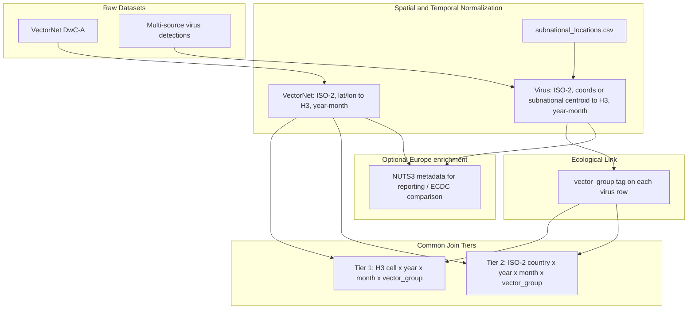

# Spatial-temporal matching strategy (Virus ↔ VectorNet)

Design specification for joining **virus detections** (multi-source extract under `data/01_raw/virus/`) with **vector detections** (VectorNet DwC-A) onto common geographic–temporal units.

| Field | Value |
|-------|-------|
| Status | Design locked and implemented through merge (`07`–`10`); `H3_RESOLUTION=4` |
| Decision date | 2026-11 (initial H3 + country tiers); 2026-11 (subnational / NUTS3 centroid → Tier 1) |
| Spec order | `03` (after vector and virus source selection) |
| Depends on | [`specs/01-vector-dataset-selection.md`](01-vector-dataset-selection.md), [`specs/02-virus-dataset-selection.md`](02-virus-dataset-selection.md) |

## Purpose

Vector Guard estimates geographic **risk / suitability** by relating vector presence patterns to virus detection patterns over space and time. Raw tables do not share a schema. This spec defines how both sides are normalized and aggregated into join keys before modelling.

The primary high-resolution spatial unit is **Uber H3** (hexagonal hierarchical spatial index), chosen so the same join key works **worldwide**. NUTS regions are **not** the canonical join unit (they are Europe-only); they **are** a valid input to **resolve lat/lon centroids** that then map into H3 Tier 1, and may also be kept as optional Europe enrichment for reporting or ECDC comparison.

Implementation (code, notebooks, feature tables) is deferred to future iterations. This document is the decision record for *how* the join should work when that work starts. Artifact ownership and resolve notebooks live in [`specs/04-reference-data-and-panel-pipeline.md`](04-reference-data-and-panel-pipeline.md).

## Inputs

| Side | Source | Key raw fields |
|------|--------|----------------|
| Vectors | VectorNet DwC-A (`data/01_raw/vector/occurrence.txt`) | `scientificName`, `countryCode` (or derived from `higherGeographyID`), `higherGeographyID`, `decimalLatitude`, `decimalLongitude`, `eventDate`, `individualCount`, sampling effort fields; optional `dynamicProperties` when present |
| Viruses | Multi-source extract (`data/01_raw/virus/virus_detections.tsv`) — see [`specs/02-virus-dataset-selection.md`](02-virus-dataset-selection.md) | `source`, `pathogen_name` / `tax_id`, `country`, `subnational_region`, `nuts_id`, `lat`, `lon`, `coord_source`, `collection_date`, `host`, `isolation_source`, accessions |

Pathogen ↔ vector-group mapping is defined in [`specs/02-virus-dataset-selection.md`](02-virus-dataset-selection.md) (target virus taxonomy table).

## High-level flow

## Spatial alignment

### Design choice: H3 over NUTS as Tier 1

| Option | Role in this strategy |
|--------|------------------------|
| **Uber H3** | **Canonical Tier 1** join unit — global, hierarchical, same cell IDs in Europe and worldwide |
| **ISO-2 country** | **Tier 2** fallback when neither exact coords nor a resolvable subnational / NUTS unit exist |
| **NUTS2/NUTS3** | **Not** the worldwide join key; **yes** as (1) input codes resolved to centroids → H3, and (2) optional Europe-only reporting metadata |

NUTS cannot support a portable worldwide pipeline by itself. H3 can, provided each Tier 1 row has a usable `(lat, lon)`—either published GPS or a **curated administrative centroid** at a scale comparable to the chosen H3 resolution.

### Locked decision: two valid paths into Tier 1

H3 assignment always uses a concrete `(lat, lon)` at the chosen `H3_RESOLUTION`. Rows may obtain that pair via **either** of the following (priority order when both exist: prefer exact GPS):

| Path | When | How `(lat, lon)` is obtained | `geo_precision` (cleaning) |
|------|------|------------------------------|----------------------------|
| **A. Direct coordinates** | Valid `lat` / `lon` on the raw row (`coord_source` of `exact_gps` or `sample_backfill` for viruses; VectorNet `decimalLatitude` / `decimalLongitude`) | Use published coordinates as-is | `exact_coords` |
| **B. Curated subnational / NUTS3 centroid** | No usable GPS, but a resolvable `(country_iso2, subnational_region)` and/or `nuts_id` matches [`data/external/subnational_locations.csv`](04-reference-data-and-panel-pipeline.md) | Lookup table supplies representative centroid `(lat, lon)` | `subnational_centroid` |

Both paths produce the same Tier 1 key: `h3_cell`. Country-only rows (no GPS and no resolvable subnational / NUTS key) stay at **Tier 2** with `geo_precision=country_only`.

### Why centroid promotion is allowed at H3 res 4–5

Indicative H3 resolutions **4–5** have edge scales on the order of **~50–150 km**, comparable to **NUTS3 / province / county** administrative units—not street addresses. Mapping a trusted admin-unit centroid into an H3 cell at that scale does **not** invent micro-precision; it places the detection in the same coarse hex that a mid-province GPS point would occupy.

This decision is required because virus sequence metadata are often country-only or `Country: region, locality` without lat/lon (current EDA: ≈2.6% coord-like `location` overall; ≈0.8% in Europe/Med), while ~29% of ENA-style rows carry a subnational string after `:`. Leaving all of those at Tier 2 would starve Europe Tier 1 co-occurrence with VectorNet.

### Guardrails (do not invent precision)

1. **Never** geocode ambiguous free-text on the fly during clean/merge without first recording the `(country_iso2, region_key)` → centroid row in `data/external/subnational_locations.csv`.
2. Only promote strings / codes that match the curated reference table (normalized keys). Unmatched region text stays country-only → **Tier 2**.
3. Prefer **exact GPS** over centroid when both are available on a row.
4. Record `geo_precision` on interim virus (and optionally vector) rows so density checks and models can distinguish `exact_coords` vs `subnational_centroid` vs `country_only`.
5. Do not treat NUTS codes as the modelling join key worldwide; always convert resolvable NUTS → centroid → `h3_cell` for Tier 1.

### Coordinate and place coverage (expected)

| Dataset | Typical geo quality | Implication |
|---------|---------------------|-------------|
| **VectorNet** | Usually has `decimalLatitude` / `decimalLongitude`; `higherGeographyID` often NUTS/GAUL | Strong direct H3 coverage inside Europe / Mediterranean; NUTS IDs useful for enrichment and optional centroid QA |
| **Virus multi-source extract** | Mix of exact GPS (ENA location / BioSample / BV-BRC / EMPRES-i), `Country: region` / Pathoplexus `division`, ECDC `nuts_id`, and country-only | Tier 1 via path A or B; Tier 2 only when neither applies |

### VectorNet side

Normalize each occurrence to:

- `country_iso2` from published `countryCode` when present; else derive from the first two characters of `higherGeographyID` (as in vector EDA)
- `lat` / `lon` from `decimalLatitude` / `decimalLongitude` when valid → Path A
- `h3_cell` = H3 index of `(lat, lon)` at the chosen resolution (Tier 1 key)
- `nuts_id` from `higherGeographyID` when present (e.g. `ITI43`, `ES241`) — enrichment and optional consistency checks against `subnational_locations.csv`; not the Tier 1 join key by itself
- `geo_precision` typically `exact_coords` when GPS present; VectorNet rows without GPS are rare—if GPS missing but `nuts_id` resolves via the reference table, Path B is allowed with `geo_precision=subnational_centroid`

### Virus side

Normalize each multi-source detection to:

- `country_iso2` parsed from `country` (ENA style often `Country: region, locality`) via `data/external/countries.csv` aliases
- `subnational_region` from the text after `:` / Pathoplexus `division` / BV-BRC place strings when present
- `nuts_id` when published (ECDC / aligned feeds)
- `(lat, lon)` resolution priority (locked; detail also in spec `04`):
  1. Source exact GPS (`lat`/`lon` with `coord_source` in `{exact_gps, sample_backfill}`) → Path A
  2. Cross-source accession / sample backfill already reflected in the raw extract → still Path A
  3. Match `(country_iso2, subnational_region | nuts_id)` to `data/external/subnational_locations.csv` → Path B centroid
  4. Else leave coords null → Tier 2 only
- `h3_cell` when a resolved `(lat, lon)` exists (Tier 1); otherwise unset
- `geo_precision` ∈ `{exact_coords, subnational_centroid, country_only}`

### Resolution tiers

Join and aggregate at the finest tier both sides support for a given unit; do not invent precision beyond the rules above.

| Tier | Spatial unit | When to use |
|------|--------------|-------------|
| **Tier 1 (high res)** | **Uber H3 cell** at a fixed resolution | Row has usable `(lat, lon)` from Path A (exact GPS) **or** Path B (curated subnational / NUTS3 centroid), mapped to `h3_cell`; virus and vector features linked via `vector_group` and time |
| **Tier 2 (broad)** | ISO-2 country | No usable GPS and no resolvable subnational / NUTS key; or H3 cannot be assigned |

Fallback ladder per record:

1. Assign `h3_cell` from exact / backfilled GPS if valid → **Tier 1** (`geo_precision=exact_coords`).
2. Else assign `h3_cell` from curated subnational / NUTS3 centroid if the reference lookup matches → **Tier 1** (`geo_precision=subnational_centroid`).
3. Else keep `country_iso2` only → **Tier 2** (`geo_precision=country_only`).
4. Optionally attach NUTS IDs for Europe reporting / ECDC comparison — never as the sole worldwide modelling key.

### H3 resolution

Pick one working resolution after a density check on VectorNet + virus coordinates (**exact_coords alone** and **exact_coords + subnational_centroid** combined). Indicative starting range for mosquito/tick risk panels: roughly **H3 resolution 4–5** (~50–150 km edge scale; confirm against data density). Use H3’s hierarchy later to coarsen or refine without redesigning join keys.

**Selection process (locked):** choose the integer resolution in `07_h3_resolution_density.ipynb` using the metrics in [`specs/04-reference-data-and-panel-pipeline.md`](04-reference-data-and-panel-pipeline.md). Do not ship a worldwide H3 geometry dump—assign `h3_cell` from lat/lon via the `h3` library. Record the chosen resolution in spec `04`, the merge panel manifest, and a code constant; keep it fixed for a given modelling panel.

To inspect an `h3_cell` ID on a map manually, use the [H3 Viewer](https://clupasq.github.io/h3-viewer/).

**Chosen value:** **`H3_RESOLUTION = 4`** (`vector_guard.resolve.H3_RESOLUTION`). Res 4 beats res 5 on Tier 1 co-occurrence under the exact+centroid production path; see notebook `07` and spec `04` for metrics.

### Geographic scope notes

- H3 makes the **spatial key** portable worldwide even when VectorNet coverage is Europe / Mediterranean–heavy.
- A truly worldwide **model** may still need non-EU vector sources later; this strategy only standardizes the join geometry.
- Extra-European virus rows with GPS or resolvable subnational centroids can enter Tier 1; country-only rows stay at Tier 2.
- **Training scope (locked):** worldwide join keys are allowed, but a unit enters the **supervised training panel** only if **VectorNet has coverage** in that unit. Virus-only units may remain for descriptive EDA. Full filter and panel contract: [`specs/04-reference-data-and-panel-pipeline.md`](04-reference-data-and-panel-pipeline.md).

## Temporal alignment

Parse VectorNet `eventDate` and virus `collection_date` (all sources) into comparable windows:

| Field | Rule |
|-------|------|
| `year` | Required for inclusion in the modelling panel |
| `month` | Required for inclusion in the modelling panel (first implementation grain) |
| `season` | Optional later fallback if month coverage proves too sparse; not the default grain |
| Date ranges | VectorNet often uses interval dates (`start/end`); use interval midpoint or start year-month consistently and record the rule in code |

Default join grain for the first implementation: **`year` × `month`** (locked). Do not match on exact calendar days. Pipeline ownership and exclusion rules for missing month: [`specs/04-reference-data-and-panel-pipeline.md`](04-reference-data-and-panel-pipeline.md).

## Ecological (taxonomic) link

Do **not** join every virus to every vector taxon.

1. Tag each virus row with `vector_group` ∈ {`mosquito`, `tick`, `biting_midge`, `sandfly`} using the taxonomy table in the virus dataset spec.
2. Map VectorNet `scientificName` (and family/order cues) into the same `vector_group`.
3. Restrict feature construction so that, for example, mosquito abundance/presence informs mosquito-borne virus risk labels, tick presence informs tick-borne viruses, and so on.
4. Optional finer filter: competent genera (e.g. `Culex` / `Aedes` for West Nile) as a secondary feature, not a hard requirement for the first join.

## Aggregation into modelling units

For each join key `(h3_cell | country_iso2, year, month, vector_group)` [and optionally `pathogen`]:

**Vector features (examples):**

- Presence / absence or count of detections
- Share of positive vs zero `individualCount` where meaningful
- Establishment signals when published
- Sampling effort proxies (`samplingProtocol`, `sampleSizeValue`) when usable

**Virus target / labels (examples):**

- Binary: any detection in the unit-window
- Count or intensity of detections (with awareness of sequencing vs outbreak-reporting bias; keep `source` distinguishable upstream)
- Optional pathogen-specific panels vs pooled by `vector_group`

**Caveats:**

- Absence of a virus row in a unit is **not** proof of pathogen absence; treat zeros as “no reported detection in the merged feeds.”
- An H3 cell with no VectorNet traps is **not** proof of vector absence (effort / coverage bias).
- Sequence detections ≠ clinical case counts; EMPRES-i / ECDC rows ≠ sequenced isolates (reporting bias remains).
- Subnational-centroid Tier 1 cells are coarser than true GPS—interpret risk at hex/admin scale, not point address scale.

## Auxiliary: VectorNet `dynamicProperties` pathogens

Sparse VectorNet rows may embed pathogen JSON (e.g. `{"pathogen": "West Nile virus"}`) when that column is present in a given archive revision. Use them only as:

- Optional **validation** against multi-source virus labels in overlapping H3 / country units, or
- Enrichment flags

They are **not** a substitute for the multi-source virus dataset in [`specs/02-virus-dataset-selection.md`](02-virus-dataset-selection.md).

## Non-goals (this strategy)

- Predicting exact first-introduction day at a site
- Using NUTS as the primary worldwide join key (centroids → H3 only)
- On-the-fly geocoding of unmatched free-text localities outside `subnational_locations.csv`
- Implementing H3 indexing, reference CSV builds, or feature pipelines in this documentation pass

## Implementation checklist (future)

Detailed reference artifacts (including `subnational_locations.csv`), notebook ownership (`05`–`10`), resolve rules, and merge panel contract live in [`specs/04-reference-data-and-panel-pipeline.md`](04-reference-data-and-panel-pipeline.md). Summary:

1. Shared normalizers for country ISO-2, dates, and `vector_group` (reference CSVs + clean notebooks)
2. Build and commit `data/external/subnational_locations.csv` from distinct virus subnational strings + European NUTS3 centroids
3. H3 cell assignment from Path A GPS or Path B centroids at the resolution chosen in `07_h3_resolution_density.ipynb`, with fallback to country when neither applies; evaluate density for exact-only vs exact+centroid
4. Optional NUTS attachment for Europe reporting (alongside H3 keys)
5. Aggregated training panel under `data/03_processed/` keyed by `(h3_cell or country_iso2, year, month, vector_group)`, with VectorNet coverage required for supervised rows
6. Notebook documenting H3 resolution choice, Tier 1 vs Tier 2 mix by `geo_precision`, class balance, and sequencing / outbreak / effort-bias caveats
7. Update to [`ROADMAP.md`](../ROADMAP.md) when reference / clean / merge items move from Planned to Done

## Related project files

| Path | Role |
|------|------|
| [`specs/01-vector-dataset-selection.md`](01-vector-dataset-selection.md) | VectorNet source |
| [`specs/02-virus-dataset-selection.md`](02-virus-dataset-selection.md) | Multi-source virus feeds + pathogen ↔ vector_group table |
| [`specs/04-reference-data-and-panel-pipeline.md`](04-reference-data-and-panel-pipeline.md) | Reference data (incl. subnational centroids), resolve steps, merge modelling panel |
| [`README.md`](../README.md) | Intended approach (join to common geo–temporal units) |
| [`ROADMAP.md`](../ROADMAP.md) | Reference / clean / merge steps Planned |
