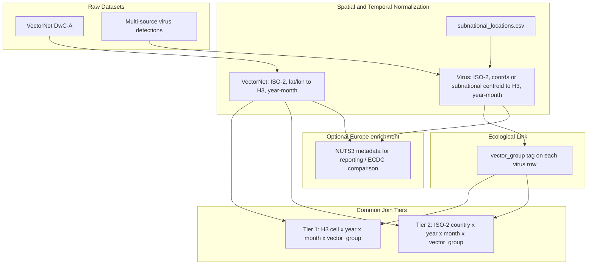

# Spatial-temporal matching strategy (Virus ↔ VectorNet)

Design specification for joining **virus detections** (multi-source extract under `data/01_raw/virus/`) with **vector detections** (VectorNet DwC-A) onto common geographic–temporal units.

| Field | Value |
|-------|-------|
| Status | Design locked and implemented through merge (`07`–`10`); `H3_RESOLUTION=4`; B2/A3 forward-label panel |
| Decision date | 2026-11 (initial H3 + country tiers); 2026-11 (subnational / NUTS3 centroid → Tier 1); 2026-11 (B2 panel rows + A3 zone eligibility + forward virus labels) |
| Spec order | `03` (after vector and virus source selection) |
| Depends on | [`specs/01-vector-dataset-selection.md`](01-vector-dataset-selection.md), [`specs/02-virus-dataset-selection.md`](02-virus-dataset-selection.md) |

## Purpose

Vector Guard estimates geographic **risk / suitability** by relating vector presence patterns to virus detection patterns over space and time. Raw tables do not share a schema. This spec defines how both sides are normalized and aggregated into join keys before modelling.

The primary high-resolution spatial unit is **Uber H3** (hexagonal hierarchical spatial index), chosen so the same join key works **worldwide**. NUTS regions are **not** the canonical join unit (they are Europe-only); they **are** a valid input to **resolve lat/lon centroids** that then map into H3 Tier 1, and may also be kept as optional Europe enrichment for reporting or ECDC comparison.

This document is the decision record for *how* the join works (tiers, Path A/B, temporal grain, ecological link). Artifact ownership, resolve notebooks, and the modelling-panel contract live in [`specs/04-reference-data-and-panel-pipeline.md`](04-reference-data-and-panel-pipeline.md).

## Inputs

| Side | Source | Key raw fields |
|------|--------|----------------|
| Vectors | VectorNet DwC-A (`data/01_raw/vector/occurrence.txt`) | `scientificName`, `countryCode` (or derived from `higherGeographyID`), `higherGeographyID`, `decimalLatitude`, `decimalLongitude`, `eventDate`, `individualCount`, sampling effort fields; optional `dynamicProperties` when present |
| Viruses | Multi-source extract (`data/01_raw/virus/virus_detections.tsv`) — see [`specs/02-virus-dataset-selection.md`](02-virus-dataset-selection.md) | `source`, `pathogen_name` / `tax_id`, `country`, `subnational_region`, `nuts_id`, `lat`, `lon`, `coord_source`, `collection_date`, `host`, `isolation_source`, accessions |

Pathogen ↔ vector-group mapping is defined in [`specs/02-virus-dataset-selection.md`](02-virus-dataset-selection.md) (target virus taxonomy table).

## High-level flow

## Spatial alignment

### Design choice: H3 over NUTS as Tier 1

| Option | Role in this strategy |
|--------|------------------------|
| **Uber H3** | **Canonical Tier 1** join unit — global, hierarchical, same cell IDs in Europe and worldwide |
| **ISO-2 country** | **Tier 2** fallback when neither exact coords nor a resolvable subnational / NUTS unit exist |
| **NUTS2/NUTS3** | **Not** the worldwide join key; **yes** as (1) input codes resolved to centroids → H3, and (2) optional Europe-only reporting metadata |

NUTS cannot support a portable worldwide pipeline by itself. H3 can, provided each Tier 1 row has a usable `(lat, lon)`—either published GPS or a **curated administrative centroid** at a scale comparable to the chosen H3 resolution.

### Locked decision: two valid paths into Tier 1

H3 assignment always uses a concrete `(lat, lon)` at the chosen `H3_RESOLUTION`. Rows may obtain that pair via **either** of the following (priority order when both exist: prefer exact GPS):

| Path | When | How `(lat, lon)` is obtained | `geo_precision` (cleaning) |
|------|------|------------------------------|----------------------------|
| **A. Direct coordinates** | Valid `lat` / `lon` on the raw row (`coord_source` of `exact_gps` or `sample_backfill` for viruses; VectorNet `decimalLatitude` / `decimalLongitude`) | Use published coordinates as-is | `exact_coords` |
| **B. Curated subnational / NUTS3 centroid** | No usable GPS, but a resolvable `(country_iso2, subnational_region)` and/or `nuts_id` matches [`data/external/subnational_locations.csv`](04-reference-data-and-panel-pipeline.md) | Lookup table supplies representative centroid `(lat, lon)` | `subnational_centroid` |

Both paths produce the same Tier 1 key: `h3_cell`. Country-only rows (no GPS and no resolvable subnational / NUTS key) stay at **Tier 2** with `geo_precision=country_only`.

Implementer priority table, ISO-2 aliases, `region_candidate_keys`, and unmatched-region artifacts: [`specs/04-reference-data-and-panel-pipeline.md`](04-reference-data-and-panel-pipeline.md) (Resolve rules).

### Why centroid promotion is allowed at H3 res 4–5

Indicative H3 resolutions **4–5** have edge scales on the order of **~50–150 km**, comparable to **NUTS3 / province / county** administrative units—not street addresses. Mapping a trusted admin-unit centroid into an H3 cell at that scale does **not** invent micro-precision; it places the detection in the same coarse hex that a mid-province GPS point would occupy.

This decision is required because virus sequence metadata are often country-only or `Country: region, locality` without lat/lon (current EDA: ≈2.6% coord-like `location` overall; ≈0.8% in Europe/Med), while ~29% of ENA-style rows carry a subnational string after `:`. Leaving all of those at Tier 2 would starve Europe Tier 1 co-occurrence with VectorNet.

### Guardrails (do not invent precision)

1. **Never** geocode ambiguous free-text on the fly during clean/merge without first recording the `(country_iso2, region_key)` → centroid row in `data/external/subnational_locations.csv`.
2. Only promote strings / codes that match the curated reference table (normalized keys). Unmatched region text stays country-only → **Tier 2**.
3. Prefer **exact GPS** over centroid when both are available on a row.
4. Record `geo_precision` on interim virus (and optionally vector) rows so density checks and models can distinguish `exact_coords` vs `subnational_centroid` vs `country_only`.
5. Do not treat NUTS codes as the modelling join key worldwide; always convert resolvable NUTS → centroid → `h3_cell` for Tier 1.

### Coordinate and place coverage (expected)

| Dataset | Typical geo quality | Implication |
|---------|---------------------|-------------|
| **VectorNet** | Usually has `decimalLatitude` / `decimalLongitude`; `higherGeographyID` often NUTS/GAUL | Strong direct H3 coverage inside Europe / Mediterranean; NUTS IDs useful for enrichment and optional centroid QA |
| **Virus multi-source extract** | Mix of exact GPS (ENA location / BioSample / BV-BRC / EMPRES-i), `Country: region` / Pathoplexus `division`, ECDC `nuts_id`, and country-only | Tier 1 via path A or B; Tier 2 only when neither applies |

### Per-side geo fields (summary)

| Side | Typical inputs into Path A / B |
|------|--------------------------------|
| **VectorNet** | `decimalLatitude` / `decimalLongitude` → Path A; else resolvable `higherGeographyID` / NUTS → Path B; else country Tier 2. `nuts_id` may stay as Europe enrichment, not the worldwide join key. |
| **Virus** | Exact / backfilled GPS (`coord_source` in `{exact_gps, sample_backfill}`) → Path A; else `(country_iso2, subnational_region \| nuts_id)` via `subnational_locations.csv` → Path B; else country Tier 2. |

Full field-by-field resolve steps: [`specs/04`](04-reference-data-and-panel-pipeline.md#resolve-rules-before-merge).

### Resolution tiers

Join and aggregate at the finest tier both sides support for a given unit; do not invent precision beyond the Path A / B guardrails above.

| Tier | Spatial unit | When to use |
|------|--------------|-------------|
| **Tier 1 (high res)** | **Uber H3 cell** at a fixed resolution | Row has usable `(lat, lon)` from Path A **or** Path B, mapped to `h3_cell`; virus and vector features linked via `vector_group` and time |
| **Tier 2 (broad)** | ISO-2 country | No usable GPS and no resolvable subnational / NUTS key; or H3 cannot be assigned |

Optional NUTS IDs for Europe reporting / ECDC comparison may attach alongside H3 keys — never as the sole worldwide modelling key.

### H3 resolution

Pick one working resolution after a density check on VectorNet + virus coordinates (**exact_coords alone** and **exact_coords + subnational_centroid** combined). Indicative starting range for mosquito/tick risk panels: roughly **H3 resolution 4–5** (~50–150 km edge scale; confirm against data density). Use H3’s hierarchy later to coarsen or refine without redesigning join keys.

**Selection process (locked):** choose the integer resolution in `07_h3_resolution_density.ipynb` using the metrics in [`specs/04-reference-data-and-panel-pipeline.md`](04-reference-data-and-panel-pipeline.md). Do not ship a worldwide H3 geometry dump—assign `h3_cell` from lat/lon via the `h3` library. Record the chosen resolution in spec `04`, the merge panel manifest, and a code constant; keep it fixed for a given modelling panel.

To inspect an `h3_cell` ID on a map manually, use the [H3 Viewer](https://clupasq.github.io/h3-viewer/).

**Chosen value:** **`H3_RESOLUTION = 4`** (`vector_guard.resolve.H3_RESOLUTION`). Res 4 beats res 5 on Tier 1 co-occurrence under the exact+centroid production path; see notebook `07` and spec `04` for metrics.

### Geographic scope notes

- H3 makes the **spatial key** portable worldwide even when VectorNet coverage is Europe / Mediterranean–heavy.
- A truly worldwide **model** may still need non-EU vector sources later; this strategy only standardizes the join geometry.
- Extra-European virus rows with GPS or resolvable subnational centroids can enter Tier 1; country-only rows stay at Tier 2.
- **Training scope (locked):** worldwide join keys are allowed, but a unit enters the **supervised training panel** only if **VectorNet has coverage** in that unit (observed VectorNet month). Virus-only units may remain for descriptive EDA. Full filter and panel contract: [`specs/04-reference-data-and-panel-pipeline.md`](04-reference-data-and-panel-pipeline.md).

## Temporal alignment

Parse VectorNet `eventDate` and virus `collection_date` (all sources) into comparable windows:

| Field | Rule |
|-------|------|
| `year` | Required for inclusion in the modelling panel |
| `month` | Required for inclusion in the modelling panel (panel row grain) |
| `season` | Optional later fallback if month coverage proves too sparse; not the default grain |
| Date ranges | VectorNet often uses interval dates (`start/end`); use interval midpoint or start year-month consistently and record the rule in code |

**Panel row grain (locked):** each supervised row is an observed VectorNet unit at **`year` × `month`** (plus spatial key and `vector_group`). Do not match on exact calendar days.

**Virus label timing (locked — B2):** virus outcomes are **not** required to share the same calendar month as the vector row. Labels look **forward and backward from the vector row timestamp** within the same `h3_cell` × `vector_group` (Tier 1) — see [Aggregation into modelling units](#aggregation-into-modelling-units). Same-month co-occurrence remains a QA column only (`virus_same_month` in spec `04`).

Pipeline ownership and exclusion rules for missing month: [`specs/04-reference-data-and-panel-pipeline.md`](04-reference-data-and-panel-pipeline.md).

## Ecological (taxonomic) link

Do **not** join every virus to every vector taxon.

1. Tag each virus row with `vector_group` ∈ {`mosquito`, `tick`, `biting_midge`, `sandfly`} using the taxonomy table in the virus dataset spec.
2. Map VectorNet `scientificName` (and family/order cues) into the same `vector_group`.
3. Restrict feature construction so that, for example, mosquito abundance/presence informs mosquito-borne virus risk labels, tick presence informs tick-borne viruses, and so on.
4. Optional finer filter: competent genera (e.g. `Culex` / `Aedes` for West Nile) as a secondary feature, not a hard requirement for the first join.

## Aggregation into modelling units

### Panel row semantics (B2 — locked)

Each supervised panel row is a **VectorNet observation unit** at `(h3_cell | country_iso2, year, month, vector_group)`. Virus labels attach relative to that row’s timestamp `T`, using Tier‑1 virus events in the **same spatial key and same `vector_group` only**.

Do **not** synthesize empty calendar months after the first vector hit; the panel skeleton stays observed VectorNet months.

### Zone eligibility (A3 — locked)

Per `(h3_cell, vector_group)` (Tier 1), compute the first VectorNet detection time (`first_vector_year` / `first_vector_month`). The zone is treated as vector-eligible **from that first hit onward**. A3 governs the **zone clock** and how virus history is interpreted relative to observed VectorNet presence; it does **not** fill months without traps.

### Virus labels relative to row time `T` (locked)

| Label family | Rule |
|--------------|------|
| Primary supervised target | `virus_within_5y` — any Tier‑1 virus in the same cell×`vector_group` with time in `(T, T+5 years]`; panel column `virus_detected` **aliases** this |
| Secondary / sensitivity | `virus_within_10y` — same, horizon **10 years** |
| Ever flags (always 0/1) | `virus_ever_before` — any virus with time **&lt; T**; `virus_ever_after` — any virus with time **&gt; T** |
| Delay (nullable) | `years_to_first_virus_after` — years to earliest virus after `T` (**null** if none); `years_since_last_virus_before` — years since latest virus before `T` (**null** if none) |
| QA / legacy | `virus_same_month` — strict same `year`×`month` co-occurrence (former same-month `virus_detected` meaning) |

Country-only virus rows (`geo_precision=country_only`) do **not** invent H3 and do **not** contribute to Tier‑1 forward / ever / delay labels. Column-level contract: [`specs/04`](04-reference-data-and-panel-pipeline.md#panel-columns).

**Worked examples** (same `h3` + `vector_group`):

| Situation | `virus_ever_before` | `virus_ever_after` | `virus_within_5y` | `virus_within_10y` |
|-----------|---------------------|--------------------|-------------------|--------------------|
| Virus only before `T`, never again | 1 | 0 | 0 | 0 |
| No virus before `T`; first virus 3y after `T` | 0 | 1 | 1 | 1 |
| Virus before `T` **and** again 3y after `T` | 1 | 1 | 1 | 1 |
| No virus before `T`; only virus 12y after `T` | 0 | 1 | 0 | 0 |
| No virus in cell at all | 0 | 0 | 0 | 0 |

### Vector features (examples)

- Presence / absence or count of detections in the row’s month
- Share of positive vs zero `individualCount` where meaningful
- Establishment signals when published
- Sampling effort proxies (`samplingProtocol`, `sampleSizeValue`) when usable
- A3 zone clock: `first_vector_year` / `first_vector_month`

### Caveats

- Absence of a virus row after `T` (or within a horizon) is **not** proof of pathogen absence; treat zeros / null delays as “no reported detection in the merged feeds” (right-censored by extract end dates).
- An H3 cell with no VectorNet traps is **not** proof of vector absence (effort / coverage bias).
- Sequence detections ≠ clinical case counts; EMPRES-i / ECDC rows ≠ sequenced isolates (reporting bias remains).
- Subnational-centroid Tier 1 cells are coarser than true GPS—interpret risk at hex/admin scale, not point address scale.
- Virus **only before** the first / this VectorNet observation (`virus_ever_before=1`, `virus_ever_after=0`) must **not** inflate the primary forward target.

## Auxiliary: VectorNet `dynamicProperties` pathogens

Sparse VectorNet rows may embed pathogen JSON (e.g. `{"pathogen": "West Nile virus"}`) when that column is present in a given archive revision. Use them only as:

- Optional **validation** against multi-source virus labels in overlapping H3 / country units, or
- Enrichment flags

They are **not** a substitute for the multi-source virus dataset in [`specs/02-virus-dataset-selection.md`](02-virus-dataset-selection.md).

## Non-goals (this strategy)

- Predicting exact first-introduction day at a site
- Using NUTS as the primary worldwide join key (centroids → H3 only)
- On-the-fly geocoding of unmatched free-text localities outside `subnational_locations.csv`
- Owning artifact paths, notebook steps, or the panel column contract (see [`specs/04`](04-reference-data-and-panel-pipeline.md))

## Implemented in

Join design from this spec is implemented through reference, H3 density, clean, and merge notebooks (`05`–`10`) with `H3_RESOLUTION=4` and the B2/A3 forward-label panel. Detailed artifacts, resolve rules, and the modelling-panel contract: [`specs/04-reference-data-and-panel-pipeline.md`](04-reference-data-and-panel-pipeline.md). Build status: [`ROADMAP.md`](../ROADMAP.md).

## Related project files

| Path | Role |
|------|------|
| [`specs/01-vector-dataset-selection.md`](01-vector-dataset-selection.md) | VectorNet source |
| [`specs/02-virus-dataset-selection.md`](02-virus-dataset-selection.md) | Multi-source virus feeds + pathogen ↔ vector_group table |
| [`specs/04-reference-data-and-panel-pipeline.md`](04-reference-data-and-panel-pipeline.md) | Reference data (incl. subnational centroids), resolve steps, merge modelling panel |
| [`README.md`](../README.md) | Intended approach (join to common geo–temporal units) |
| [`ROADMAP.md`](../ROADMAP.md) | Build status (data foundation Done; EDA / models next) |
