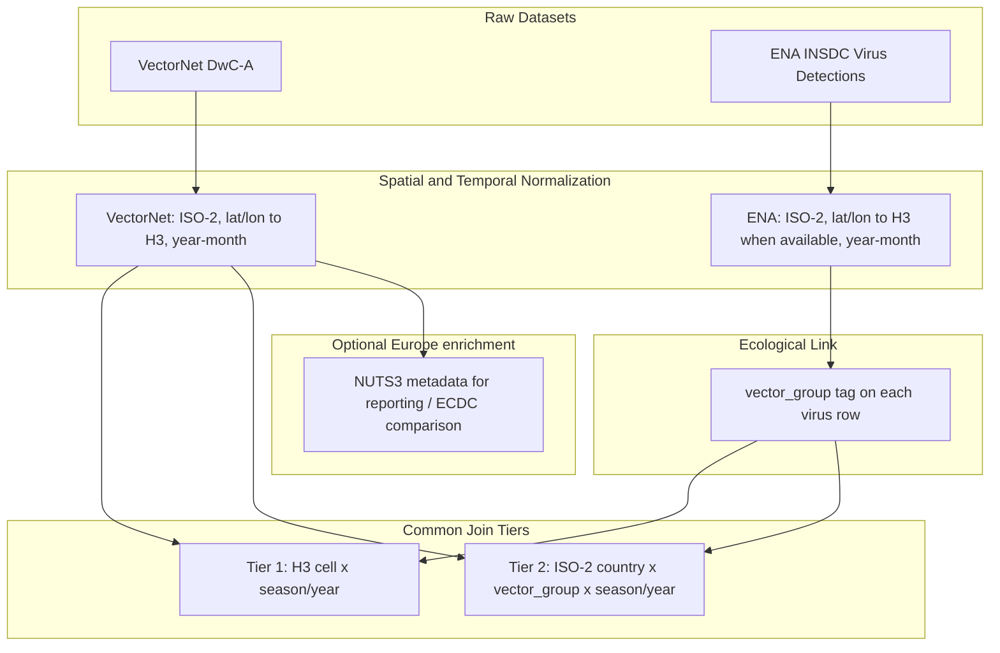

# Spatial-temporal matching strategy (Virus ↔ VectorNet)

Design specification for joining **virus detections** (ENA / INSDC) with **vector detections** (VectorNet DwC-A) onto common geographic–temporal units.

| Field | Value |
|-------|-------|
| Status | Design only — **not implemented** in this iteration |
| Decision date | 2026-11 |
| Spec order | `03` (after vector and virus source selection) |
| Depends on | [`specs/01-vector-dataset-selection.md`](01-vector-dataset-selection.md), [`specs/02-virus-dataset-selection.md`](02-virus-dataset-selection.md) |

## Purpose

Vector Guard estimates geographic **risk / suitability** by relating vector presence patterns to virus detection patterns over space and time. Raw tables do not share a schema. This spec defines how both sides are normalized and aggregated into join keys before modelling.

The primary high-resolution spatial unit is **Uber H3** (hexagonal hierarchical spatial index), chosen so the same join key works **worldwide**. NUTS regions are **not** the canonical join unit (they are Europe-only); they may be kept as optional Europe enrichment for reporting or ECDC comparison.

Implementation (code, notebooks, feature tables) is deferred to future iterations. This document is the decision record for *how* the join should work when that work starts.

## Inputs

| Side | Source | Key raw fields |
|------|--------|----------------|
| Vectors | VectorNet DwC-A (`data/raw/vector/occurrence.txt`) | `scientificName`, `countryCode`, `higherGeographyID`, `higherGeography`, `decimalLatitude`, `decimalLongitude`, `eventDate`, `degreeOfEstablishment`, `individualCount`, optional `dynamicProperties` |
| Viruses | ENA / INSDC extract (`data/raw/virus/…`, planned) | pathogen / `tax_id`, `country`, `location` / lat–lon, `collection_date`, `host`, `isolation_source` |

Pathogen ↔ vector-group mapping is defined in [`specs/02-virus-dataset-selection.md`](02-virus-dataset-selection.md) (target virus taxonomy table).

## High-level flow

## Spatial alignment

### Design choice: H3 over NUTS as Tier 1

| Option | Role in this strategy |
|--------|------------------------|
| **Uber H3** | **Canonical Tier 1** join unit — global, hierarchical, same cell IDs in Europe and worldwide |
| **ISO-2 country** | **Tier 2** fallback when coordinates are missing |
| **NUTS2/NUTS3** | **Optional Europe-only metadata** — not used as the worldwide join key |

NUTS cannot support a portable worldwide pipeline. H3 can, provided rows have usable coordinates.

### Coordinate requirement

H3 assignment requires valid `lat` / `lon`. Expected coverage:

| Dataset | Typical geo quality | Implication |
|---------|---------------------|-------------|
| **VectorNet** | Usually has `decimalLatitude` / `decimalLongitude` | Strong H3 coverage inside Europe / Mediterranean |
| **ENA** | Often **country-only** or fuzzy `Country: region, locality`; lat/lon incomplete | Many virus rows fall to Tier 2 unless coordinates exist |

**Do not invent precision:** region-name text without a trusted geocode stays at country tier. Optional careful geocoding of ENA localities may be explored later; it is not required for the first join.

### VectorNet side

Normalize each occurrence to:

- `country_iso2` from `countryCode`
- `lat` / `lon` from `decimalLatitude` / `decimalLongitude` when valid
- `h3_cell` = H3 index of `(lat, lon)` at the chosen resolution (Tier 1 key)
- Optional: `nuts_id` from `higherGeographyID` when present (e.g. `ITI43`, `ES241`) — **enrichment only**
- Optional coarse label from `higherGeography` (`Country | Region`) for QA

### Virus (ENA) side

Normalize each sequence/isolate record to:

- `country_iso2` parsed from `country` (ENA style often `Country: region, locality`)
- `lat` / `lon` when `location` or explicit coordinate fields are present
- `h3_cell` when coordinates are valid (Tier 1); otherwise leave unset and use Tier 2
- Optional `admin_name` / region string for QA — **not** mapped to NUTS as a required join step

### Resolution tiers

Join and aggregate at the finest tier both sides support for a given unit; do not invent precision.

| Tier | Spatial unit | When to use |
|------|--------------|-------------|
| **Tier 1 (high res)** | **Uber H3 cell** at a fixed resolution | Both sides have usable coordinates mapped to the same `h3_cell` (virus and vector detections in that cell, linked via `vector_group` and time) |
| **Tier 2 (broad)** | ISO-2 country | Virus or vector lacks coordinates; or H3 cannot be assigned |

Fallback ladder per record:

1. Assign `h3_cell` if lat/lon valid → eligible for **Tier 1** aggregation.
2. Else keep `country_iso2` only → **Tier 2** only.
3. Optionally attach NUTS IDs for Europe VectorNet rows for reporting — never as the sole worldwide key.

### H3 resolution

Pick one working resolution after a density check on VectorNet + ENA coordinates. Indicative starting range for mosquito/tick risk panels: roughly **H3 resolution 4–5** (~50–150 km edge scale; confirm against data density). Use H3’s hierarchy later to coarsen or refine without redesigning join keys.

**Selection process (locked):** choose the integer resolution in planned notebook `07_h3_resolution_density.ipynb` using the metrics in [`specs/04-reference-data-and-panel-pipeline.md`](04-reference-data-and-panel-pipeline.md). Do not ship a worldwide H3 geometry dump—assign `h3_cell` from lat/lon via the `h3` library. Record the chosen resolution in spec `04`, the merge panel manifest, and a code constant; keep it fixed for a given modelling panel.

### Geographic scope notes

- H3 makes the **spatial key** portable worldwide even when VectorNet coverage is Europe / Mediterranean–heavy.
- A truly worldwide **model** may still need non-EU vector sources later; this strategy only standardizes the join geometry.
- Extra-European ENA rows with coordinates can enter Tier 1; country-only rows stay at Tier 2.
- **Training scope (locked):** worldwide join keys are allowed, but a unit enters the **supervised training panel** only if **VectorNet has coverage** in that unit. Virus-only units may remain for descriptive EDA. Full filter and panel contract: [`specs/04-reference-data-and-panel-pipeline.md`](04-reference-data-and-panel-pipeline.md).

## Temporal alignment

Parse VectorNet `eventDate` and ENA `collection_date` into comparable windows:

| Field | Rule |
|-------|------|
| `year` | Required for inclusion in the modelling panel |
| `month` | Required for inclusion in the modelling panel (first implementation grain) |
| `season` | Optional later fallback if month coverage proves too sparse; not the default grain |
| Date ranges | VectorNet often uses interval dates (`start/end`); use interval midpoint or start year-month consistently and record the rule in code |

Default join grain for the first implementation: **`year` × `month`** (locked). Do not match on exact calendar days. Pipeline ownership and exclusion rules for missing month: [`specs/04-reference-data-and-panel-pipeline.md`](04-reference-data-and-panel-pipeline.md).

## Ecological (taxonomic) link

Do **not** join every virus to every vector taxon.

1. Tag each virus row with `vector_group` ∈ {`mosquito`, `tick`, `biting_midge`, `sandfly`} using the taxonomy table in the virus dataset spec.
2. Map VectorNet `scientificName` (and family/order cues) into the same `vector_group`.
3. Restrict feature construction so that, for example, mosquito abundance/presence informs mosquito-borne virus risk labels, tick presence informs tick-borne viruses, and so on.
4. Optional finer filter: competent genera (e.g. `Culex` / `Aedes` for West Nile) as a secondary feature, not a hard requirement for the first join.

## Aggregation into modelling units

For each join key `(h3_cell | country_iso2, year, month, vector_group)` [and optionally `pathogen`]:

**Vector features (examples):**

- Presence / absence or count of detections
- Share of positive vs zero `individualCount` where meaningful
- Establishment signals (`degreeOfEstablishment`)
- Sampling effort proxies (`samplingProtocol`, `sampleSizeValue`) when usable

**Virus target / labels (examples):**

- Binary: any detection in the unit-window
- Count or intensity of sequence detections (with awareness of sequencing bias)
- Optional pathogen-specific panels vs pooled by `vector_group`

**Caveats:**

- Absence of a virus row in a unit is **not** proof of pathogen absence; treat zeros as “no reported sequenced detection.”
- An H3 cell with no VectorNet traps is **not** proof of vector absence (effort / coverage bias).
- Sequence detections ≠ clinical case counts (sequencing bias remains).

## Auxiliary: VectorNet `dynamicProperties` pathogens

Sparse VectorNet rows embed pathogen JSON (e.g. `{"pathogen": "West Nile virus"}`). Use them only as:

- Optional **validation** against ENA-derived labels in overlapping H3 / country units, or
- Enrichment flags

They are **not** a substitute for the ENA virus dataset.

## Non-goals (this strategy)

- Predicting exact first-introduction day at a site
- Using NUTS as the primary worldwide join unit
- Clinical case counts from ECDC Atlas as the primary join partner (may appear later as an external validation layer)
- Implementing H3 indexing, geocoders, or feature pipelines in this iteration

## Implementation checklist (future)

Detailed reference artifacts, notebook ownership (`05`–`10`), resolve rules, and merge panel contract live in [`specs/04-reference-data-and-panel-pipeline.md`](04-reference-data-and-panel-pipeline.md). Summary:

1. Shared normalizers for country ISO-2, dates, and `vector_group` (reference CSVs + clean notebooks)
2. H3 cell assignment from lat/lon at the resolution chosen in `07_h3_resolution_density.ipynb`, with fallback to country when coordinates are missing
3. Optional NUTS attachment for Europe VectorNet rows (reporting only)
4. Aggregated training panel under `data/processed/` keyed by `(h3_cell or country_iso2, year, month, vector_group)`, with VectorNet coverage required for supervised rows
5. Notebook documenting H3 resolution choice, Tier 1 vs Tier 2 coverage mix, class balance, and sequencing / effort-bias caveats
6. Update to [`ROADMAP.md`](../ROADMAP.md) when reference / clean / merge items move from Planned to Done

## Related project files

| Path | Role |
|------|------|
| [`specs/01-vector-dataset-selection.md`](01-vector-dataset-selection.md) | VectorNet source |
| [`specs/02-virus-dataset-selection.md`](02-virus-dataset-selection.md) | ENA source + pathogen ↔ vector_group table |
| [`specs/04-reference-data-and-panel-pipeline.md`](04-reference-data-and-panel-pipeline.md) | Reference data, resolve steps, merge modelling panel |
| [`README.md`](../README.md) | Intended approach (join to common geo–temporal units) |
| [`ROADMAP.md`](../ROADMAP.md) | Reference / clean / merge steps Planned |
