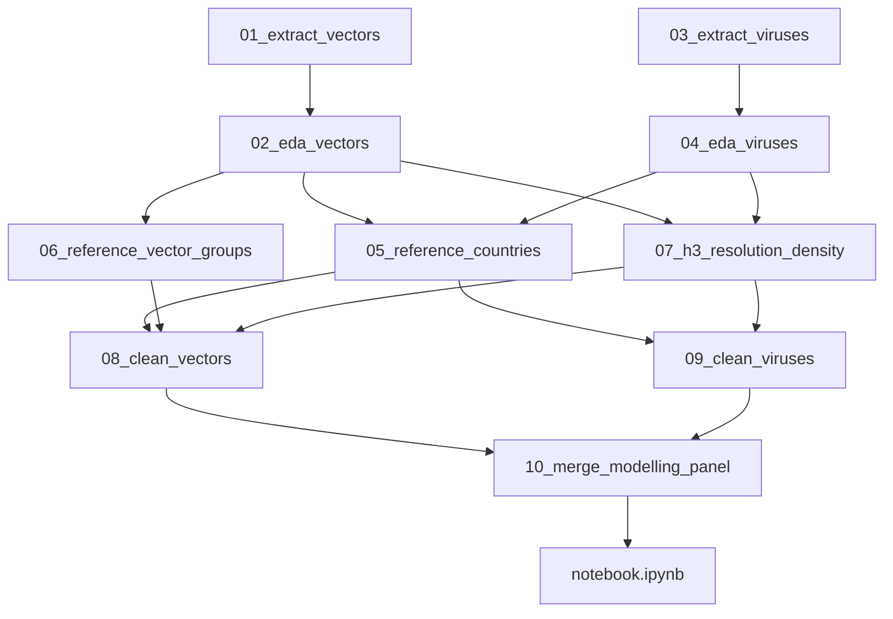

# Reference data and modelling-panel pipeline

Decision record for **reference / master data**, how each side is **resolved** onto join keys, and the **merge** step that produces the final modelling panel used for analysis and training.

| Field | Value |
|-------|-------|
| Status | Partially implemented — `countries.csv` + `subnational_locations.csv` via `05_reference_countries.ipynb`; vector groups / H3 / clean / merge still open |
| Decision date | 2026-11 (initial pipeline); 2026-11 (multi-source virus extract + subnational centroid reference) |
| Spec order | `04` (after spatial-temporal matching strategy) |
| Depends on | [`specs/03-spatial-temporal-matching-strategy.md`](03-spatial-temporal-matching-strategy.md), [`specs/01-vector-dataset-selection.md`](01-vector-dataset-selection.md), [`specs/02-virus-dataset-selection.md`](02-virus-dataset-selection.md) |

## Locked pipeline decisions

| Decision | Choice |
|----------|--------|
| Geographic keys | Worldwide join keys allowed (H3 / ISO-2) |
| Tier 1 paths | Exact / backfilled GPS **or** curated subnational / NUTS3 centroids → `(lat, lon)` → `h3_cell` (see spec `03`) |
| Training filter | A unit enters the **training** panel only if **VectorNet has coverage** in that unit; virus-only units may appear in descriptive EDA, not as supervised rows that imply vector context |
| Temporal grain | **`year` × `month`** |
| H3 resolution | Chosen later in a density-check notebook; document the process here; record the chosen integer when selected |
| Virus raw extract | Multi-source unified `virus_detections.tsv` (ENA `sequence` + `read_run`/`sample`, BV-BRC, Pathoplexus, EMPRES-i, ECDC) — contract in spec `02`; upgrade **Planned** |
| This iteration | Reference countries + subnational centroids implemented (`05`); remaining pipeline steps still Planned |

Join geometry and tier rules remain defined in [`specs/03-spatial-temporal-matching-strategy.md`](03-spatial-temporal-matching-strategy.md). This spec owns **artifacts, storage, notebook ownership, resolve rules, and the merge contract**.

## Data ladder

```text
data/
  raw/           # extracts only (gitignored); notebooks 01, 03
  reference/     # committed master/lookup tables; notebooks 05, 06
  interim/       # normalized vector / virus row tables; notebooks 08, 09
  processed/     # modelling panel + merge manifest; notebook 10
```

| Layer | Contents | Commit? |
|-------|----------|---------|
| `raw/` | VectorNet DwC-A; multi-source `virus_detections.tsv` (+ `manifest.json`) | No (re-fetch documented in README) |
| `reference/` | Countries, subnational centroids, vector taxon → group maps (small) | Yes |
| `interim/` | Per-side normalized detections | Usually no (rebuildable) |
| `processed/` | Aggregated modelling panel | Prefer commit if small; else document rebuild |

## What counts as reference data

**Uber H3 is not a downloaded master table.** Cell IDs are computed from `(lat, lon)` with the `h3` library at a fixed resolution. Do not store a worldwide H3 geometry dump for the join.

**ISO-2 countries, subnational / NUTS3 centroid lookups, name aliases, and vector_group maps are reference data** and live under `data/reference/`.

| Artifact | Nature | Path (when implemented) | How generated | Used to resolve |
|----------|--------|-------------------------|---------------|-----------------|
| Countries + aliases + scope flags | Static reference CSV | `data/reference/countries.csv` | Curated from ISO 3166-1 + virus / VectorNet name aliases observed in EDA | Virus `country` → `country_iso2`; validate VectorNet ISO-2; QA / scope flags |
| Subnational / NUTS3 centroids | Static reference CSV | `data/reference/subnational_locations.csv` | Distinct virus region strings + European NUTS3/GAUL centroids (NUTS / GADM / GeoNames) | `(country_iso2, subnational_region \| nuts_id)` → centroid `(lat, lon)` → Tier 1 H3 |
| Pathogen ↔ `vector_group` | Project config (code) | [`src/vector_guard/data.py`](../src/vector_guard/data.py) `VIRUS_VECTOR_TAXON_MAP`; optional mirror `data/reference/pathogen_vector_group.csv` | From [`specs/02-virus-dataset-selection.md`](02-virus-dataset-selection.md) | Tag virus rows; ecological join filter |
| Vector taxon → `vector_group` | Static reference CSV | `data/reference/vector_taxon_groups.csv` | Curated from VectorNet `scientificName` inventory (EDA) | Tag VectorNet rows before aggregate / join |
| H3 resolution choice | Decision + code constant | Recorded in this spec (when chosen) and a future `H3_RESOLUTION` constant | Density-check notebook `07_h3_resolution_density.ipynb` | `lat/lon` → `h3_cell` |
| Modelling panel schema | Output contract | `data/processed/modelling_panel.*` | Merge notebook `10_merge_modelling_panel.ipynb` | Course EDA / `notebook.ipynb` / `train.py` |

**Out of reference scope (v1):** full NUTS polygon geometry dumps; on-the-fly geocoders for unmatched free-text; committing raw extracts. NUTS **centroids** (and equivalent admin centroids) **are** in scope via `subnational_locations.csv`.

### `countries.csv` — generation rules

Planned columns (minimum):

| Column | Meaning |
|--------|---------|
| `iso2` | ISO 3166-1 alpha-2 code |
| `name` | Canonical English short name |
| `name_aliases` | Pipe- or semicolon-separated alternate spellings seen in virus feeds / VectorNet (e.g. `Czech Republic` / `Czechia`, `Russia` / `Russian Federation`) |
| `in_vectornet_scope` | Boolean / `0|1` — country appears (or is expected) in VectorNet Europe / Mediterranean coverage; used for QA and optional filters, **not** as the sole training gate |
| `europe_med` | Boolean / `0|1` — Europe / Mediterranean basin flag for descriptive splits (replaces hardcoded notebook sets) |

Generation process (notebook `05_reference_countries.ipynb`):

1. Start from a complete ISO 3166-1 alpha-2 list (library or authoritative public table).
2. Add aliases from unmatched virus `country` tokens (after stripping `Country: region…`) found in `04_eda_viruses` and, after the multi-source upgrade, from BV-BRC / Pathoplexus / EMPRES-i / ECDC country strings.
3. Mark `in_vectornet_scope` / `europe_med` from VectorNet country inventory (`02_eda_vectors`) plus the known VectorNet geographic remit.
4. Write `data/reference/countries.csv` and note row count / alias coverage in a short cell or sidecar note (optional `manifest` fields later).

### `subnational_locations.csv` — generation rules

Planned columns (minimum):

| Column | Meaning |
|--------|---------|
| `country_iso2` | ISO 3166-1 alpha-2 of the parent country |
| `region_key` | Normalized match key: lowercased / trimmed region string **or** NUTS/GAUL code (e.g. `emilia-romagna`, `iti43`) |
| `region_type` | One of `admin1`, `admin2`, `nuts3`, `locality` |
| `canonical_name` | Human-readable name for QA / docs |
| `lat` | Representative centroid latitude (WGS84) |
| `lon` | Representative centroid longitude (WGS84) |
| `source_authority` | Provenance of the centroid, e.g. `NUTS_2024`, `GADM`, `GeoNames` |

Generation process (same notebook family as countries — `05_reference_countries.ipynb`, with a dedicated section or follow-on cells for subnational rows):

1. Inventory distinct `(country, subnational_region)` / `nuts_id` values from the virus raw extract (ENA-style `Country: region`, Pathoplexus `division`, BV-BRC place strings, ECDC NUTS3 codes) and optionally VectorNet `higherGeographyID` for Europe consistency.
2. Normalize to `region_key` under a documented rule (casefold, strip punctuation, map common aliases).
3. Resolve each key to a trusted centroid from NUTS (Europe), GADM admin1/admin2, or GeoNames—**only** when the administrative scale is comparable to H3 res 4–5 (~50–150 km). Skip or leave unmatched ambiguous micro-localities.
4. Write `data/reference/subnational_locations.csv` (committed). Unmatched virus region strings remain country-only until a curated row is added—**never** invent a centroid in `09_clean_viruses` without updating this file.

### `vector_taxon_groups.csv` — generation rules

Planned columns (minimum):

| Column | Meaning |
|--------|---------|
| `scientific_name` | Exact or normalized VectorNet `scientificName` string |
| `vector_group` | One of `mosquito`, `tick`, `biting_midge`, `sandfly` |
| `notes` | Optional (genus-level rule, uncertain taxa) |

Generation process (notebook `06_reference_vector_groups.ipynb`):

1. Inventory distinct `scientificName` values from VectorNet.
2. Map each name (or genus rule) into the four `vector_group` values used by the virus taxonomy table.
3. Leave unmapped taxa out of the ecological join (or flag for manual review); do not invent a fifth group for v1.
4. Write `data/reference/vector_taxon_groups.csv`.

Pathogen → `vector_group` stays authoritative in `VIRUS_VECTOR_TAXON_MAP` / spec `02`. An optional CSV mirror is for transparency only and must not drift from the code map without an explicit update.

### H3 resolution — selection process (not a static dump)

Notebook `07_h3_resolution_density.ipynb` chooses one integer resolution and records it; it does **not** ship a global H3 cell list.

**Candidates:** start with resolutions **4 and 5** (indicative ~50–150 km edge scale per spec `03`); optionally probe one coarser/finer neighbor if metrics are ambiguous.

**Metrics to compare** (report **twice** where noted: `exact_coords` only, and `exact_coords + subnational_centroid`):

| Metric | Intent |
|--------|--------|
| Share of detections assignable to an H3 cell | Tier 1 eligibility (exact-only vs exact+centroid) |
| Cells with ≥1 VectorNet detection | Vector coverage density |
| Cells with ≥1 virus detection among Tier 1-eligible rows | Virus Tier 1 density (exact-only vs exact+centroid) |
| Share of virus Tier 1 rows whose H3 cell also has VectorNet in the same `year`×`month`×`vector_group` | Empty-join / co-occurrence pressure under each geo mode |
| Median detections per occupied cell | Over-fragmentation vs lumping |
| Mix of `geo_precision` among Tier 1 virus rows | Transparency on how much Tier 1 relies on centroids |

**Selection rule:** pick the finest resolution that still yields a usable Tier 1 co-occurrence rate and stable cell occupancy for modelling under the **exact + centroid** mode (the locked production path); also document exact-only metrics as a sensitivity check. Prefer interpretability over micro-cells with almost no overlaps. Record the chosen `H3_RESOLUTION` in this spec (update when decided), in ROADMAP notes, and in the merge panel manifest.

## Pipeline ownership



| Step | Notebook (planned) | Writes | Reads |
|------|--------------------|--------|-------|
| Extract vectors | `01_extract_vectors.ipynb` (exists) | `data/raw/vector/` | VectorNet DwC-A URL |
| Extract viruses | `03_extract_viruses.ipynb` (exists; **multi-source upgrade Planned**) | `data/raw/virus/virus_detections.tsv` + `manifest.json` | ENA Portal (`sequence`, `read_run`, `sample`); BV-BRC; Pathoplexus; FAO EMPRES-i; ECDC NUTS3 / seasonal tables — see [Virus extract contract](#virus-extract-contract-notebook-03) |
| Source EDA vectors | `02_eda_vectors.ipynb` (exists) | Insights / cleaning rules only | raw vectors |
| Source EDA viruses | `04_eda_viruses.ipynb` (exists; extend after upgrade) | Insights / cleaning rules only | raw viruses |
| Country + subnational reference | `05_reference_countries.ipynb` | `data/reference/countries.csv`, `data/reference/subnational_locations.csv` | ISO list + alias / region / NUTS needs from EDA |
| Vector group map | `06_reference_vector_groups.ipynb` | `data/reference/vector_taxon_groups.csv` | VectorNet `scientificName` inventory |
| H3 density check | `07_h3_resolution_density.ipynb` | Decision in specs/ROADMAP (+ later code constant); no world H3 dump | lat/lon from both sides under exact-only and exact+centroid modes |
| Clean vectors | `08_clean_vectors.ipynb` | `data/interim/vectors_normalized.parquet` (or CSV) | raw + `countries` + optional `subnational_locations` + `vector_taxon_groups` + `H3_RESOLUTION` |
| Clean viruses | `09_clean_viruses.ipynb` | `data/interim/viruses_normalized.parquet` (or CSV) | raw + `countries` + `subnational_locations` + taxon map + `H3_RESOLUTION` |
| **Merge panel** | `10_merge_modelling_panel.ipynb` | `data/processed/modelling_panel.parquet` (+ tier mix / manifest summary) | both interim tables |
| Course EDA + models | `notebook.ipynb` (later) | model artifacts | modelling panel |

Source EDA notebooks (`02`, `04`) diagnose quality and relevance; they do **not** own the final modelling table. Cleaning notebooks apply documented rules; the merge notebook owns the panel contract.

### Virus extract contract (notebook `03`)

Aligned with [`specs/02-virus-dataset-selection.md`](02-virus-dataset-selection.md). **v1 (live today):** ENA `result=sequence` only for the twelve implemented taxa. **Upgrade (Planned):**

1. Expand `VIRUS_VECTOR_TAXON_MAP` (planned taxa in spec `02`); verify ENA `tax_tree` counts before locking IDs.
2. Fetch and normalize feeds into one table:
   - ENA `result=sequence`
   - ENA `result=read_run` + `result=sample` (coordinate / date backfill via `sample_accession`)
   - BV-BRC Genome API
   - Pathoplexus LAPIS (listed arboviruses)
   - FAO EMPRES-i (and related open outbreak extracts where reproducible)
   - ECDC Surveillance Atlas / seasonal NUTS3 tables
3. Write unified `data/raw/virus/virus_detections.tsv` using the canonical columns in spec `02` (`record_id`, `source`, accessions, pathogen tags, `country`, `subnational_region`, `nuts_id`, `lat`, `lon`, `coord_source`, `collection_date`, host fields, …).
4. Apply INSDC vs outbreak dedupe rules from spec `02`.
5. Write `manifest.json` with fetch time, citations, SHA-256, **per-source** counts, and per-pathogen counts.

`load_virus_detections()` continues to load the unified TSV; schema-tolerant updates land with the extract upgrade (not in this docs-only pass).

## Resolve rules (before merge)

Apply these when building interim normalized tables.

### Country → `country_iso2`

| Side | Rule |
|------|------|
| VectorNet | Prefer published `countryCode` when present; else derive ISO-2 from the first two characters of `higherGeographyID` (as in `02_eda_vectors`). Validate against `countries.csv`. |
| Virus (all sources) | Parse the country token before `:` in `country` when ENA-style (e.g. `Italy: Tuscany` → `Italy`). Map via `name` / `name_aliases` → `iso2`. Apply the same alias table to BV-BRC / Pathoplexus / EMPRES-i / ECDC country fields. |
| Unmapped | Flag; exclude from modelling keys until resolved (do not invent ISO codes). |

### Coordinates → `(lat, lon)` → `h3_cell` (priority locked)

Resolve virus (and, if needed, vector) coordinates in this order before assigning H3:

| Priority | Rule | Resulting `geo_precision` |
|----------|------|---------------------------|
| 1 | Use source exact GPS when `lat`/`lon` valid (`coord_source` in `{exact_gps, sample_backfill}` for viruses; VectorNet decimal coords) | `exact_coords` |
| 2 | Prefer any richer exact coords already merged across INSDC sources in the raw extract (accession / sample backfill) — still treated as exact | `exact_coords` |
| 3 | Match `(country_iso2, normalized subnational_region)` or `nuts_id` to `data/reference/subnational_locations.csv`; use table `lat`/`lon` | `subnational_centroid` |
| 4 | No match → leave coords null | `country_only` |

Then:

| Rule | Detail |
|------|--------|
| Valid resolved lat/lon | Assign `h3_cell` at the chosen `H3_RESOLUTION` → eligible for **Tier 1**. |
| Missing / invalid coords after the ladder | Leave `h3_cell` null → **Tier 2 only** (`country_iso2`). |
| Guardrail | Do **not** call external geocoders inside `09_clean_viruses` for unmatched strings; add a curated row to `subnational_locations.csv` instead. |
| Prefer GPS | If exact GPS and a centroid match both exist, keep exact GPS and `geo_precision=exact_coords`. |

### Time → `year`, `month`

| Rule | Detail |
|------|--------|
| Grain | Modelling keys use **`year` × `month`**. |
| Required | Rows without a usable `year` and `month` are excluded from the modelling panel. |
| VectorNet intervals | `eventDate` often has start/end; use a **documented, consistent** rule (prefer interval midpoint’s year-month, or start year-month if midpoint is undefined) and record it in `08_clean_vectors`. |
| Virus (all sources) | Parse `collection_date` (or outbreak observation / reporting date) to year-month; partial dates that lack month drop out of the panel (may remain in descriptive EDA). |

### Ecology → `vector_group`

| Side | Rule |
|------|------|
| Viruses | From `VIRUS_VECTOR_TAXON_MAP` / extract tags (`pathogen_name`, `vector_group`). |
| Vectors | Join / map `scientificName` via `vector_taxon_groups.csv`. |
| Merge | Aggregate and join **only within the same** `vector_group`. |

## Merge step — modelling panel

**Goal:** one final dataset for model analysis and generation (`notebook.ipynb`, later `train.py`).

### Unit definition

Panel rows are **spatial–temporal units**, not raw detection rows.

| Tier | Key | When |
|------|-----|------|
| Tier 1 | `(h3_cell, year, month, vector_group)` | Unit has usable H3 on the vector side (Path A GPS or Path B centroid); virus features/labels attached when virus rows share that cell-window |
| Tier 2 | `(country_iso2, year, month, vector_group)` | Fallback when H3 cannot be used for that unit |

Prefer Tier 1 when the vector side supports it; attach virus aggregates at the same key. Country-only virus rows (no GPS and no centroid match) contribute at **Tier 2** only—do not invent H3 for them.

### Training filter

- **Include** units with **VectorNet coverage** (vector feature present for that key).
- Virus detection in the unit-window becomes the **label / target** (e.g. binary any detection in the merged feeds and/or count). Optionally retain source-mix summaries (sequence vs outbreak) as features or QA columns.
- Virus-only units (no VectorNet in that key) may be exported for descriptive EDA but are **excluded from the supervised training panel**.
- Caveats from spec `03` still apply: virus zero ≠ true absence; no VectorNet traps ≠ true vector absence; sequences ≠ clinical cases; centroid Tier 1 ≠ point GPS precision.

### Aggregation (indicative columns)

**Vector features (examples):** detection count or presence; optional `individualCount` summaries; sampling-effort proxies when usable.

**Virus labels (examples):** `virus_detected` (0/1); `virus_detection_count`; optional later pathogen-specific columns; optional counts split by `source` family.

**Required identity / meta columns:**

| Column | Meaning |
|--------|---------|
| `spatial_tier` | `h3` or `country` |
| `h3_cell` | Set when `spatial_tier == h3`; else null |
| `country_iso2` | Always preferred when known (Tier 2 key; also useful metadata on Tier 1) |
| `year`, `month` | Temporal grain |
| `vector_group` | Ecological link |
| Vector feature columns | As implemented in merge |
| Virus label columns | As implemented in merge |

Optional panel QA fields (recommended): share of contributing virus rows with `geo_precision=exact_coords` vs `subnational_centroid` for Tier 1 units.

### Outputs

| Path | Role |
|------|------|
| `data/processed/modelling_panel.parquet` (or `.csv`) | Modelling handoff table |
| Merge summary / manifest fields | `H3_RESOLUTION`, row counts by `spatial_tier`, geo-precision mix, date range, training filter rules, source raw manifests’ SHA-256 when available |

Consumers: `notebook.ipynb` (EDA on the panel + model selection), `train.py` (load panel or rebuild via the same pipeline).

## Non-goals (this spec / docs-only pass)

- Implementing notebooks `05`–`10`, extract upgrade code, or loader schema changes in this documentation pass
- Committing `data/raw/` extracts
- Choosing the numeric H3 resolution in this documentation pass
- Shipping full NUTS polygon dumps or calling live geocoders for unmatched free-text
- Defining the final ML feature set beyond the panel contract above

## Implementation checklist (future)

1. Upgrade `03_extract_viruses.ipynb` + `VIRUS_VECTOR_TAXON_MAP` to the multi-source contract (spec `02`); refresh `04_eda_viruses` for per-source / geo coverage.
2. Add `data/reference/` via notebook `05`: commit `countries.csv` and `subnational_locations.csv`. **Done (files written; commit when ready).**
3. Add `vector_taxon_groups.csv` via notebook `06`.
4. Run `07_h3_resolution_density.ipynb` (exact-only vs exact+centroid); update this spec with the chosen `H3_RESOLUTION`.
5. Implement `08_clean_vectors` / `09_clean_viruses` writers to `data/interim/` using the coordinate priority ladder and `geo_precision`.
6. Implement `10_merge_modelling_panel` → `data/processed/modelling_panel.*` + manifest summary.
7. Point `notebook.ipynb` / `train.py` at the panel.
8. Mark corresponding ROADMAP rows Done.

## Related project files

| Path | Role |
|------|------|
| [`specs/03-spatial-temporal-matching-strategy.md`](03-spatial-temporal-matching-strategy.md) | Tier geometry, Path A/B into H3, ecological link principles |
| [`specs/01-vector-dataset-selection.md`](01-vector-dataset-selection.md) | VectorNet source |
| [`specs/02-virus-dataset-selection.md`](02-virus-dataset-selection.md) | Multi-source virus feeds, unified schema, pathogen ↔ vector_group |
| [`README.md`](../README.md) | Data ladder and intended approach |
| [`ROADMAP.md`](../ROADMAP.md) | Build status for reference / clean / merge steps |
