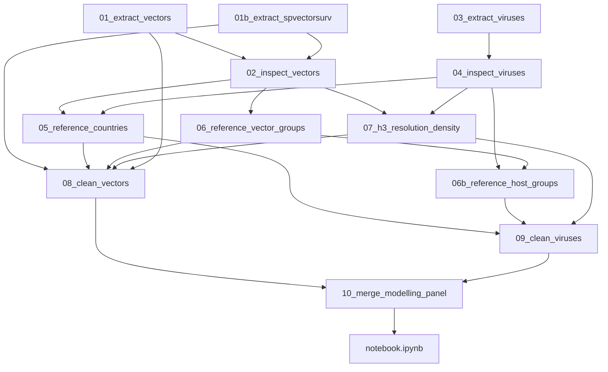

# Reference data and modelling-panel pipeline

Decision record for **reference / master data**, how each side is **resolved** onto join keys, and the **merge** step that produces the final modelling panel used for analysis and training.

| Field | Value |
|-------|-------|
| Status | **B2 pathogen-long** panel + **long species side table** contract locked (`H3_RESOLUTION=4`, A3 clock); notebook `10` → `modelling_panel.*` + `modelling_panel_species.parquet`; wide `vector_count_*` are an EDA/prep late pivot, not merge columns; virus interim `host_group` classification locked (merge does **not** consume it yet); **vector interim multi-source** (VectorNet primary + SPVECTORSURV secondary) with closed `source` column |
| Decision date | 2026-11 (initial pipeline); 2026-11 (multi-source virus extract + subnational centroid reference); 2026-11 (`H3_RESOLUTION=4`); 2026-11 (Path B lookup parity + virus spelling aliases); 2026-11 (virus ENA / ISO-week date parsing); 2026-11 (B2/A3 forward virus labels); 2026-11 (B2 pathogen-long grain + pathogen-specific labels); 2026-11 (long species composition side table + late priority pivot); 2026-11 (virus `host` → `host_group`); 2026-11 (SPVECTORSURV secondary vector source → interim `source`) |
| Spec order | `04` (after spatial-temporal matching strategy) |
| Depends on | [`specs/03-spatial-temporal-matching-strategy.md`](03-spatial-temporal-matching-strategy.md), [`specs/01-vector-dataset-selection.md`](01-vector-dataset-selection.md), [`specs/02-virus-dataset-selection.md`](02-virus-dataset-selection.md) |

## Locked pipeline decisions

| Decision | Choice |
|----------|--------|
| Geographic keys | Worldwide join keys allowed (H3 / ISO-2) |
| Tier 1 paths | Exact / backfilled GPS **or** curated subnational / NUTS3 centroids → `(lat, lon)` → `h3_cell` (see spec `03`) |
| Training filter | A unit enters the **training** panel only if **vector coverage** exists in that unit (observed interim vector month from any selected source); virus-only units may appear in descriptive EDA, not as supervised rows that imply vector context |
| Panel row semantics | **B2 pathogen-long** — one row per observed vector `(spatial key, year, month, vector_group)` **×** each `pathogen_name` mapped to that `vector_group`; pathogen-specific labels relative to the row timestamp |
| Pathogen explosion | Full factorial: every observed vector unit × **all** pathogens in `VIRUS_VECTOR_TAXON_MAP` for that `vector_group` (explicit negatives) |
| Zone eligibility | **A3** — per `(h3_cell, vector_group)`, zone clock from **first** interim vector detection onward (`first_vector_year` / `first_vector_month`); **not** per pathogen; no synthetic empty months |
| Vector raw extract | Multi-source: VectorNet observations (primary) + SPVECTORSURV (secondary densifier) — contract in [`specs/01`](01-vector-dataset-selection.md); unioned in notebook `08` |
| Vector interim `source` | Closed vocabulary on `vectors_normalized.parquet`: `vectornet` \| `spvectorsurv` (row provenance; not a panel join key) |
| Primary label | `pathogen_within_5y` (forward ≤5 years, same cell × **this** `pathogen_name`) |
| Secondary label | `pathogen_within_10y` (forward ≤10 years); ever-before / ever-after flags + nullable delay columns for EDA |
| Temporal grain | Panel rows: **`year` × `month`** (vector observation). Pathogen labels are **not** same-month-only (see spec `03`) |
| Vector species features | Panel: group aggregates + `species_richness` only (no merge-time `vector_count_*`). Full composition in long `modelling_panel_species.parquet` (unit × `scientific_name`). EDA/prep: unit-grain pivot of the **locked** closed set from `priority_vector_taxa.csv` → `vector_count_<feature_slug>` (0 if absent); frequency pivots of the full long table are exploratory only |
| H3 resolution | **`4`** — chosen in `07_h3_resolution_density.ipynb`; constant `vector_guard.resolve.H3_RESOLUTION` |
| Virus raw extract | Multi-source unified `virus_detections.tsv` (ENA `sequence` + `read_run`/`sample`, BV-BRC, Pathoplexus, EMPRES-i, ECDC) — contract in [`specs/02`](02-virus-dataset-selection.md) |
| Virus `host_group` | Interim classification of free-text `host` (+ `isolation_source` fallback when unresolved) into a closed vocabulary on `viruses_normalized.parquet`; merge notebook `10` does **not** consume `host_group` in this milestone |
| Pipeline scope | Virus extract + reference + H3 + clean + merge (`03`–`10`); modelling panel at `data/03_processed/` |

Join geometry and tier rules remain defined in [`specs/03-spatial-temporal-matching-strategy.md`](03-spatial-temporal-matching-strategy.md). This spec owns **artifacts, storage, notebook ownership, resolve rules, and the merge contract**.

## Data ladder

```text
data/
  01_raw/        # extracts only (gitignored); notebooks 01, 01b, 03
  external/      # committed master/lookup tables; notebooks 05, 06, 06b
  02_interim/    # normalized vector / virus row tables; notebooks 08, 09
  03_processed/  # modelling panel + species side table + merge manifest; notebook 10
```

| Layer | Contents | Commit? |
|-------|----------|---------|
| `01_raw/` | VectorNet DwC-A (`vector/`); SPVECTORSURV DwC-A (`vector_spvectorsurv/`); multi-source `virus_detections.tsv` (+ per-extract `manifest.json`) | No (re-fetch documented in README) |
| `external/` | Countries, subnational centroids, vector taxon → group maps, host → `host_group` aliases, priority taxa, pathogen ↔ group mirror (small) | Yes |
| `02_interim/` | Per-side normalized detections (+ rebuildable unmatched region / host lists); vectors carry `source` | Usually no (rebuildable) |
| `03_processed/` | Modelling panel + long species composition table + merge manifest | Prefer commit if small; else document rebuild |

## What counts as reference data

**Uber H3 is not a downloaded master table.** Cell IDs are computed from `(lat, lon)` with the `h3` library at a fixed resolution. Do not store a worldwide H3 geometry dump for the join.

**ISO-2 countries, subnational / NUTS3 centroid lookups, name aliases, vector_group maps, host → `host_group` aliases, pathogen ↔ group mirror, and priority vector taxa are reference data** and live under `data/external/`.

| Artifact | Nature | Path | How generated | Used to resolve |
|----------|--------|------|---------------|-----------------|
| Countries + aliases + scope flags | Static reference CSV | `data/external/countries.csv` | Curated from ISO 3166-1 + virus / VectorNet name aliases observed in EDA | Virus `country` → `country_iso2`; validate VectorNet ISO-2; QA / scope flags |
| Subnational / NUTS3 centroids | Static reference CSV | `data/external/subnational_locations.csv` (~7.8k rows incl. virus spelling aliases) | Distinct virus region strings + European NUTS3/NE admin1 centroids + original spelling aliases | `(country_iso2, subnational_region \| nuts_id)` → centroid `(lat, lon)` → Tier 1 H3 |
| Pathogen ↔ `vector_group` | Project config (code) + committed mirror | [`src/vector_guard/data.py`](../src/vector_guard/data.py) `VIRUS_VECTOR_TAXON_MAP`; mirror `data/external/pathogen_vector_group.csv` | From [`specs/02-virus-dataset-selection.md`](02-virus-dataset-selection.md); mirror written by notebook `06` | Tag virus rows; ecological join filter; **panel pathogen explosion** |
| Vector taxon → `vector_group` | Static reference CSV | `data/external/vector_taxon_groups.csv` | Curated from VectorNet + SPVECTORSURV `scientificName` inventory (notebook `06`) | Tag interim vector rows before aggregate / join |
| Host → `host_group` aliases | Static reference CSV | `data/external/host_groups.csv` | Curated from virus `host` inventory + VectorNet / global vector taxa seeds (notebook `06b`) | Tag virus interim rows with closed `host_group` (EDA / future label splits; **not** a merge key) |
| Priority vector taxa (EDA / prep) | Static reference CSV | `data/external/priority_vector_taxa.csv` | Top / competent genera–species per `vector_group` from VectorNet frequency (notebook `06`) | **Locked** closed set for late unit-grain pivot → `vector_count_<feature_slug>` in EDA/prep / `train.py` handoff — **not** merge panel columns |
| H3 resolution choice | Decision + code constant | This spec + `vector_guard.resolve.H3_RESOLUTION` (`4`) | Density-check notebook `07_h3_resolution_density.ipynb` | `lat/lon` → `h3_cell` |
| Modelling panel schema | Output contract | `data/03_processed/modelling_panel.*` | Merge notebook `notebooks/01_sources/10_merge_modelling_panel.ipynb` | Primary EDA / `notebook.ipynb` / `train.py` (pathogen-long; no wide species counts) |
| Species composition (long) | Output contract | `data/03_processed/modelling_panel_species.parquet` | Same merge notebook (`10`), from pre-explode unit aggregates | Unit × `scientific_name` counts for late pivot in EDA/prep |

**Out of reference scope (v1):** full NUTS polygon geometry dumps; on-the-fly geocoders for unmatched free-text; committing raw extracts. NUTS **centroids** (and equivalent admin centroids) **are** in scope via `subnational_locations.csv`.

### `countries.csv` — generation rules

Columns:

| Column | Meaning |
|--------|---------|
| `iso2` | ISO 3166-1 alpha-2 code |
| `name` | Canonical English short name |
| `name_aliases` | Pipe- or semicolon-separated alternate spellings seen in virus feeds / VectorNet (e.g. `Czech Republic` / `Czechia`, `Russia` / `Russian Federation`) |
| `in_vectornet_scope` | Boolean / `0|1` — country appears (or is expected) in VectorNet Europe / Mediterranean coverage; used for QA and optional filters, **not** as the sole training gate |
| `europe_med` | Boolean / `0|1` — Europe / Mediterranean basin flag for descriptive splits (replaces hardcoded notebook sets) |

Generation process (notebook `notebooks/01_sources/05_reference_countries.ipynb`):

1. Start from a complete ISO 3166-1 alpha-2 list (library or authoritative public table).
2. Add aliases from unmatched virus `country` tokens (after stripping `Country: region…`) found across all multi-source feeds (ENA, BV-BRC, Pathoplexus, EMPRES-i, ECDC).
3. Mark `in_vectornet_scope` / `europe_med` from VectorNet country inventory (`02_inspect_vectors`) plus the known VectorNet geographic remit.
4. Write `data/external/countries.csv` and note row count / alias coverage in a short cell or sidecar note (optional `manifest` fields later).

### `subnational_locations.csv` — generation rules

Columns:

| Column | Meaning |
|--------|---------|
| `country_iso2` | ISO 3166-1 alpha-2 of the parent country |
| `region_key` | Normalized match key: lowercased / trimmed region string **or** NUTS/GAUL code (e.g. `emilia-romagna`, `iti43`) |
| `region_type` | One of `admin1`, `admin2`, `nuts3`, `locality` |
| `canonical_name` | Human-readable name for QA / docs |
| `lat` | Representative centroid latitude (WGS84) |
| `lon` | Representative centroid longitude (WGS84) |
| `source_authority` | Provenance of the centroid, e.g. `NUTS_2024`, `GADM`, `GeoNames` |

Generation process (same notebook family as countries — `notebooks/01_sources/05_reference_countries.ipynb`, with a dedicated section or follow-on cells for subnational rows):

1. Inventory distinct `(country, subnational_region)` / `nuts_id` values from the virus raw extract (ENA-style `Country: region`, Pathoplexus `division`, BV-BRC place strings, ECDC NUTS3 codes) and optionally VectorNet `higherGeographyID` for Europe consistency.
2. Normalize to `region_key` under a documented rule (casefold, strip punctuation, map common aliases).
3. Resolve each key to a trusted centroid from NUTS (Europe), GADM admin1/admin2, or GeoNames—**only** when the administrative scale is comparable to H3 res 4–5 (~50–150 km). Skip or leave unmatched ambiguous micro-localities.
4. Write `data/external/subnational_locations.csv` (committed). When a free-text region resolves via a secondary candidate, also persist the **original** normalized virus spelling as an alias row (same centroid). Extend curated `REGION_ALIASES` for high-frequency VectorNet-scope misses. Unmatched virus region strings remain country-only until a curated row is added—**never** invent a centroid in `09_clean_viruses` without updating this file. Notebook `09` writes rebuildable `data/02_interim/virus_unmatched_regions.csv` (with `in_vectornet_scope`) to guide follow-up curation.

### `vector_taxon_groups.csv` — generation rules

Columns:

| Column | Meaning |
|--------|---------|
| `scientific_name` | Exact or normalized vector `scientificName` string (VectorNet bare names and SPVECTORSURV authored forms after normalize) |
| `vector_group` | One of `mosquito`, `tick`, `biting_midge`, `sandfly` |
| `notes` | Optional (genus-level rule, uncertain taxa) |

Generation process (notebook `notebooks/01_sources/06_reference_vector_groups.ipynb`):

1. Inventory distinct `scientificName` values from **both** vector raw extracts (VectorNet + SPVECTORSURV).
2. Map each name (or genus rule) into the four `vector_group` values used by the virus taxonomy table.
3. Leave unmapped taxa out of the ecological join (or flag for manual review); do not invent a fifth group for v1.
4. Write `data/external/vector_taxon_groups.csv`.

### `pathogen_vector_group.csv` — generation rules

Committed mirror of the pathogen ↔ `vector_group` map for transparency and merge inputs. **Authoritative source remains** `VIRUS_VECTOR_TAXON_MAP` in [`src/vector_guard/data.py`](../src/vector_guard/data.py) / spec `02`. The CSV must not drift from the code map without an explicit dual update.

Columns:

| Column | Meaning |
|--------|---------|
| `pathogen_name` | Canonical pathogen name (same vocabulary as the virus extract) |
| `vector_group` | One of `mosquito`, `tick`, `biting_midge`, `sandfly` |

Generation process (notebook `06`, same family as vector taxon groups):

1. Export one row per entry in `VIRUS_VECTOR_TAXON_MAP`.
2. Write `data/external/pathogen_vector_group.csv`.
3. Merge notebook uses this table (or the code map) to **explode** observed vector units to pathogen-long panel rows.

### `host_groups.csv` — generation rules

Committed alias table mapping free-text virus host strings to a closed `host_group` vocabulary. Used only when cleaning viruses into interim rows; merge notebook `10` does **not** read this file in this milestone.

Columns:

| Column | Meaning |
|--------|---------|
| `host_key` | Normalized match key via `norm_key()` (unique, non-empty) |
| `host_group` | One of the locked vocabulary values **except** `unknown` (unresolved hosts stay `unknown` at classify time) |
| `notes` | Provenance tag (e.g. `vectornet_taxon`, `global_vector_genus`, `curated_vertebrate`, `ecdc_token`, `lab_line`) |

**Locked `host_group` vocabulary:**

| Value | Meaning |
|-------|---------|
| `mosquito`, `tick`, `biting_midge`, `sandfly` | Arthropod vector groups (same names as VectorNet `vector_group`) |
| `human` | Human / *Homo sapiens* |
| `livestock` | Non-human domestic mammals (incl. `Domestic - unspecified mammal` and domestic companion mammals) |
| `bird` | Avian hosts (incl. wild birds and avian outbreak tokens) |
| `wildlife_mammal` | Wild non-avian mammals |
| `lab` | Cell lines / culture / clone / vaccine material |
| `unknown` | Blank, placeholder, or unresolved after the full ladder (not stored as a curated CSV target) |

Generation process (notebook `notebooks/01_sources/06b_reference_host_groups.ipynb`):

1. Inventory distinct `host` / `isolation_source` strings and frequencies from raw `virus_detections.tsv`.
2. Seed arthropod aliases from `vector_taxon_groups.csv` plus global non-European vector genera / higher taxa present in virus feeds (`Haemaphysalis`, `Amblyomma`, `Ochlerotatus`, `Culicidae`, `Ixodoidea`, …).
3. Curate high-frequency vertebrate, outbreak-feed (`ecdc_atlas`, `empres_i`), and lab-line aliases into `host_key` → `host_group` rows.
4. Write `data/external/host_groups.csv` (committed). Assert unique `host_key` and valid `host_group` values. Residual frequent unmatched hosts guide follow-up curation; notebook `09` also writes rebuildable `data/02_interim/virus_unmatched_hosts.csv`.

### `priority_vector_taxa.csv` — generation rules

Closed list of VectorNet taxa used as the **locked modelling feature set** after the EDA/prep unit-grain pivot. Do **not** one-hot all ~200+ `scientific_name` values into the panel, and do **not** substitute a frequency-selected open set for the modelling handoff. Merge does **not** read this file.

Columns:

| Column | Meaning |
|--------|---------|
| `scientific_name` | Exact VectorNet `scientific_name` string to match (genus- or species-level as published) |
| `vector_group` | One of `mosquito`, `tick`, `biting_midge`, `sandfly` — must match the taxon’s group in `vector_taxon_groups.csv` |
| `feature_slug` | Stable snake_case token used as late-pivot column suffix (`vector_count_<feature_slug>`); unique within the file |
| `notes` | Optional (e.g. frequency rank, competent genus) |

Generation process (notebook `06`):

1. From VectorNet (or interim vectors), rank `scientific_name` frequency **within each** `vector_group`.
2. Keep roughly **10–15** taxa per group: highest-frequency names plus dominant competent genera that already appear as rows (`Culex`, `Aedes`, `Anopheles`, `Ixodes`, `Culicoides`, `Phlebotomus`, …).
3. Assign a unique `feature_slug` per row (e.g. `culex_pipiens`, `aedes`, `ixodes_ricinus`).
4. Write `data/external/priority_vector_taxa.csv` (committed).
5. At **EDA / prep** (not merge): after filtering the pathogen-long panel, restrict `modelling_panel_species` to those unit keys, pivot this closed set to `vector_count_<feature_slug>` (0 if absent), and left-merge onto pathogen-long rows. Unmatched taxa remain in the long side table and still contribute to panel `vector_detection_count` / `species_richness` at merge.

### H3 resolution — selection process (not a static dump)

Notebook `07_h3_resolution_density.ipynb` chooses one integer resolution and records it; it does **not** ship a global H3 cell list.

**Candidates:** start with resolutions **4 and 5** (indicative ~50–150 km edge scale per spec `03`); optionally probe one coarser/finer neighbor if metrics are ambiguous.

**Metrics to compare** (report **twice** where noted: `exact_coords` only, and `exact_coords + subnational_centroid`):

| Metric | Intent |
|--------|--------|
| Share of detections assignable to an H3 cell | Tier 1 eligibility (exact-only vs exact+centroid) |
| Cells with ≥1 VectorNet detection | Vector coverage density |
| Cells with ≥1 virus detection among Tier 1-eligible rows | Virus Tier 1 density (exact-only vs exact+centroid) |
| Share of virus Tier 1 rows whose H3 cell also has VectorNet in the same `year`×`month`×`vector_group` | Empty-join / co-occurrence pressure under each geo mode |
| Median detections per occupied cell | Over-fragmentation vs lumping |
| Mix of `geo_precision` among Tier 1 virus rows | Transparency on how much Tier 1 relies on centroids |

**Selection rule:** pick the finest resolution that still yields a usable Tier 1 co-occurrence rate and stable cell occupancy for modelling under the **exact + centroid** mode (the locked production path); also document exact-only metrics as a sensitivity check. Prefer interpretability over micro-cells with almost no overlaps. Record the chosen `H3_RESOLUTION` in this spec, in `vector_guard.resolve.H3_RESOLUTION`, and in the merge panel manifest.

**Decision (2026-11):** `H3_RESOLUTION = 4`. Under `exact_plus_centroid`, res 4 retains ~3× the hex×month×`vector_group` co-occurring virus rows of res 5 (~128 vs ~45) with stable median occupancy (~3–4 virus detections per occupied cell). Res 5 over-fragments relative to VectorNet coverage. Res 3 was probed as a coarser neighbor (~335 co-occurring rows) but is outside the primary candidate band; production stays at 4. Absolute co-occurrence remains sparse (Europe/Med vector extract vs worldwide virus extract); the **vector-coverage** training filter still applies at merge (any selected interim vector source). Details: [`notebooks/01_sources/07_h3_resolution_density.ipynb`](../notebooks/01_sources/07_h3_resolution_density.ipynb).

**Path B lookup parity (locked):** Runtime `lookup_subnational_centroid` in [`src/vector_guard/resolve.py`](../src/vector_guard/resolve.py) uses the same trailing-first `region_candidate_keys` / `strip_admin_suffix` logic as notebook `05` (comma / ` - ` / `;` segments). Notebook `05` persists original virus spelling aliases into `subnational_locations.csv` and curated `REGION_ALIASES` for high-frequency VectorNet-scope misses. Unmatched keys go to rebuildable `data/02_interim/virus_unmatched_regions.csv` for follow-up curation—never invent centroids in `09_clean_viruses`.

**Virus date formats (locked):** `parse_collection_sort_key` / `parse_year_month_virus` in [`src/vector_guard/virus_extract.py`](../src/vector_guard/virus_extract.py) and [`src/vector_guard/resolve.py`](../src/vector_guard/resolve.py) accept ISO `YYYY-MM(-DD)`, ENA `dd-Mon-yyyy` / `Mon-yyyy`, and ISO week `YYYY-Www` (Monday of that week → calendar month). Bare years lack month and stay panel-excluded (grain remains `year × month`; season fallback deferred).

**Locate a cell on a map:** paste any panel / interim `h3_cell` ID into the [H3 Viewer](https://clupasq.github.io/h3-viewer/) to inspect its hexagon on a basemap.

## Pipeline ownership



| Step | Notebook | Writes | Reads |
|------|----------|--------|-------|
| Extract vectors (primary) | `notebooks/01_sources/01_extract_vectors.ipynb` | `data/01_raw/vector/` | VectorNet DwC-A URL — [`specs/01`](01-vector-dataset-selection.md) |
| Extract vectors (secondary) | `notebooks/01_sources/01b_extract_spvectorsurv.ipynb` | `data/01_raw/vector_spvectorsurv/` | SPVECTORSURV IPT DwC-A URL — [`specs/01`](01-vector-dataset-selection.md) |
| Extract viruses | `notebooks/01_sources/03_extract_viruses.ipynb` | `data/01_raw/virus/virus_detections.tsv` + `manifest.json` | Multi-source feeds — contract in [`specs/02`](02-virus-dataset-selection.md) |
| Source inspect vectors | `notebooks/01_sources/02_inspect_vectors.ipynb` | Insights / cleaning rules only | raw VectorNet (+ SPVECTORSURV when present) |
| Source inspect viruses | `notebooks/01_sources/04_inspect_viruses.ipynb` | Insights / cleaning rules only | raw viruses |
| Country + subnational reference | `notebooks/01_sources/05_reference_countries.ipynb` | `data/external/countries.csv`, `data/external/subnational_locations.csv` | ISO list + alias / region / NUTS needs from multi-source extract; unmatched list from `09` |
| Vector group map + pathogen mirror + priority taxa | `notebooks/01_sources/06_reference_vector_groups.ipynb` | `data/external/vector_taxon_groups.csv`; `pathogen_vector_group.csv`; `priority_vector_taxa.csv` | VectorNet + SPVECTORSURV `scientificName` inventory; `VIRUS_VECTOR_TAXON_MAP` |
| Host → `host_group` aliases | `notebooks/01_sources/06b_reference_host_groups.ipynb` | `data/external/host_groups.csv` | Virus `host` / `isolation_source` inventory; `vector_taxon_groups.csv`; global vector genus seeds |
| H3 density check | `07_h3_resolution_density.ipynb` | Decision in this spec + `vector_guard.resolve.H3_RESOLUTION`; no world H3 dump | lat/lon from both sides under exact-only and exact+centroid modes |
| Clean vectors | `notebooks/01_sources/08_clean_vectors.ipynb` | `data/02_interim/vectors_normalized.parquet` (incl. `source`) | VectorNet + SPVECTORSURV raw + `countries` + optional `subnational_locations` + `vector_taxon_groups` + `H3_RESOLUTION` |
| Clean viruses | `notebooks/01_sources/09_clean_viruses.ipynb` | `data/02_interim/viruses_normalized.parquet` (incl. `host_group`); `data/02_interim/virus_unmatched_regions.csv` (`in_vectornet_scope` flag); `data/02_interim/virus_unmatched_hosts.csv` | raw + `countries` + `subnational_locations` + `host_groups.csv` + `vector_taxon_groups` + `H3_RESOLUTION` |
| **Merge panel** | `notebooks/01_sources/10_merge_modelling_panel.ipynb` | `data/03_processed/modelling_panel.parquet` + `modelling_panel_species.parquet` + `modelling_panel_manifest.json` | both interim tables + `pathogen_vector_group.csv` (**not** `priority_vector_taxa.csv`; **not** `host_group` / `host_groups.csv` in this milestone) |
| Primary EDA + models | `notebook.ipynb` | Panel prep + locked late species pivot; model training next (see ROADMAP) | modelling panel + species side table + `priority_vector_taxa.csv` |

Source inspect notebooks (`02`, `04` under `notebooks/01_sources/`) diagnose quality and relevance; they do **not** own the final modelling table and are **not** the project EDA deliverable. Cleaning notebooks apply documented rules; the merge notebook owns the panel + species side-table contract.

Virus raw extract schema, feeds, and taxonomy: [`specs/02-virus-dataset-selection.md`](02-virus-dataset-selection.md) (notebook `03` implements that contract).

## Resolve rules (before merge)

Apply these when building interim normalized tables. **Join principles** (Path A / B, Tier 1 vs 2, guardrails, temporal grain, ecological link) are defined in [`specs/03-spatial-temporal-matching-strategy.md`](03-spatial-temporal-matching-strategy.md). This section is the implementer contract only.

### Country → `country_iso2`

| Side | Rule |
|------|------|
| Vectors (VectorNet + SPVECTORSURV) | Prefer published `countryCode` when present; else derive ISO-2 from the first two characters of `higherGeographyID` (as in `02_inspect_vectors`). Validate against `countries.csv`. |
| Virus (all sources) | Parse the country token before `:` in `country` when ENA-style (e.g. `Italy: Tuscany` → `Italy`). Map via `name` / `name_aliases` → `iso2`. Apply the same alias table to BV-BRC / Pathoplexus / EMPRES-i / ECDC country fields. |
| Unmapped | Flag; exclude from modelling keys until resolved (do not invent ISO codes). |

### Coordinates → `(lat, lon)` → `h3_cell` (priority locked)

Implements Path A → Path B → Tier 2 from spec `03`. Resolve virus (and, if needed, vector) coordinates in this order before assigning H3:

| Priority | Rule | Resulting `geo_precision` |
|----------|------|---------------------------|
| 1 | Use source exact GPS when `lat`/`lon` valid (`coord_source` in `{exact_gps, sample_backfill}` for viruses; vector DwC-A decimal coords) | `exact_coords` |
| 2 | Prefer any richer exact coords already merged across INSDC sources in the raw extract (accession / sample backfill) — still treated as exact | `exact_coords` |
| 3 | Match `(country_iso2, normalized subnational_region)` or `nuts_id` to `data/external/subnational_locations.csv` via `region_candidate_keys` (trailing-first admin tokens after `,` / ` - ` / `;`, plus `strip_admin_suffix`); use table `lat`/`lon` | `subnational_centroid` |
| 4 | No match → leave coords null | `country_only` |

Then:

| Rule | Detail |
|------|--------|
| Valid resolved lat/lon | Assign `h3_cell` at `H3_RESOLUTION` → **Tier 1** |
| Missing / invalid coords after the ladder | Leave `h3_cell` null → **Tier 2** (`country_iso2`) |
| Unmatched region strings | Persist to `data/02_interim/virus_unmatched_regions.csv` for notebook `05` curation; do not geocode inside `09_clean_viruses` (guardrails in spec `03`) |

### Time → `year`, `month`

Temporal grain principle (`year` × `month` locked): [`specs/03`](03-spatial-temporal-matching-strategy.md#temporal-alignment).

| Rule | Detail |
|------|--------|
| Grain | Modelling keys use **`year` × `month`**. |
| Required | Rows without a usable `year` and `month` are excluded from the modelling panel. |
| Vector intervals (all sources) | `eventDate` often has start/end; use a **documented, consistent** rule (prefer interval midpoint’s year-month, or start year-month if midpoint is undefined) and record it in `08_clean_vectors`. |
| Virus (all sources) | Parse `collection_date` (or outbreak observation / reporting date) via `parse_year_month_virus` → `parse_collection_sort_key`. |
| Virus accepted forms | ISO `YYYY-MM` / `YYYY-MM-DD`; ENA / GenBank `dd-Mon-yyyy` and `Mon-yyyy`; ISO week `YYYY-Www` mapped to the Monday of that week’s calendar month. |
| Virus excluded | Year-only (`YYYY`), empty / unparseable, and other strings without a recoverable calendar month — drop from the panel (may remain in descriptive EDA). Do **not** invent a month for bare years. |

### Ecology → `vector_group` and pathogen explosion

Ecological join principle (same `vector_group` only; pathogen-long rows): [`specs/03`](03-spatial-temporal-matching-strategy.md#ecological-taxonomic-link).

| Side | Rule |
|------|------|
| Viruses | From `VIRUS_VECTOR_TAXON_MAP` / extract tags (`pathogen_name`, `vector_group`). |
| Vectors | Join / map `scientificName` via `vector_taxon_groups.csv` (normalize authored / parenthetical names when needed so SPVECTORSURV strings hit the same keys as VectorNet). |
| Merge | Aggregate interim vectors at `(spatial key, year, month, vector_group)`; explode to pathogens via `pathogen_vector_group.csv` / `VIRUS_VECTOR_TAXON_MAP`; attach labels on `(spatial key, pathogen_name)` within the same `vector_group`. |
| Species features | At merge: compute `species_richness` on the unit; write long `modelling_panel_species` (unit × `scientific_name` × `detection_count`, count ≥ 1; **no** `pathogen_name`). At EDA/prep: unit-grain pivot of locked `priority_vector_taxa.csv` → `vector_count_<feature_slug>` (0 if absent), then left-merge onto the filtered pathogen-long panel. |

### Vectors interim contract (`vectors_normalized.parquet`)

Written by notebook `08` from **both** raw vector extracts. Row grain = one occurrence after resolve.

| Column | Meaning |
|--------|---------|
| `record_id` | Publisher `id` / `occurrenceID` (namespaces differ by source; not unique across sources alone) |
| `source` | Closed provenance: `vectornet` \| `spvectorsurv` |
| `scientific_name` | Resolved / published taxon string used for mapping |
| `vector_group` | From `vector_taxon_groups.csv` (empty / null when unmapped — kept for QA; merge drops from panel keys) |
| `country_iso2`, `lat`, `lon`, `geo_precision`, `h3_cell` | Resolve ladder as above |
| `year`, `month` | Midpoint rule from `eventDate` |
| `nuts_id` | From `higherGeographyID` when present |
| `individual_count`, `sampling_protocol`, `sample_size_value` | Effort fields passthrough |

**Union rules:** concatenate VectorNet + SPVECTORSURV after the same resolve path; **no** cross-source dedup drop. Soft-overlap QA may report `(rounded lat/lon, scientific_name, year, month)` collisions. SPVECTORSURV rows remain CC BY-NC 4.0; combined interim is multi-license ([`specs/01`](01-vector-dataset-selection.md)).

### Host → `host_group` (virus interim only)

Detection-level metadata on `viruses_normalized.parquet`. Distinguishes arthropod vector hosts from vertebrate / lab / unknown sample hosts. **Not** a join key to VectorNet `scientific_name`. Merge notebook `10` does **not** consume `host_group` in this milestone (panel labels remain any-host pathogen events). Implemented in `vector_guard.resolve.classify_host_group` and applied by `09_clean_viruses`.

**Segment pre-clean on `host`:**

1. Split on multi-host delimiters (`|` and `;`).
2. Strip trailing outbreak case-count suffixes (e.g. ECDC `human:22` → `human`, `equid_outbreaks:1` → `equid_outbreaks`).
3. Treat empty strings and placeholders (`missing`, `unknown`, `na`, `n/a`, `none`, `not applicable`, `not collected`) as blank.

**Per-segment ladder (first match wins):**

| Priority | Rule | Result |
|----------|------|--------|
| 1 | Exact `norm_key()` match in `data/external/host_groups.csv` | Curated `host_group` |
| 2 | Lab / culture markers in `host` (`vero`, `c6/36`, `bhk`, `cell line`, `cell culture`, `cells`, `cdna clone`, `vaccine`) — **before** taxon prefix matching | `lab` |
| 3 | Arthropod taxon: binomial / first-token genus via `vector_taxon_groups.csv` **plus** global non-EU genera / higher taxa (`Haemaphysalis`, `Amblyomma`, `Ochlerotatus`, `Culicidae`, `Ixodoidea`, …) and unambiguous English vector terms | `mosquito` / `tick` / `biting_midge` / `sandfly` |
| 4 | Vertebrate cues in order: human → avian (before generic `Wild -`) → domestic mammal (`Domestic -`, livestock common names, companion mammals) → remaining wild mammal | `human` / `bird` / `livestock` / `wildlife_mammal` |

**Multi-segment tie-break:** when `|` / `;` segments resolve to different groups, pick one primary value by biological priority:

`mosquito` / `tick` / `biting_midge` / `sandfly` > `bird` > `wildlife_mammal` > `livestock` > `human` > `lab` > `unknown`

**`isolation_source` fallback** — only when `host` resolves to `unknown`. Do **not** override a resolved `host` (clinical / animal hosts passaged in cells stay vertebrate). When falling back:

1. Lab markers first (`cell culture`, `vero`, `c6/36`, `ap 61`, `cultured virus stock`, `vaccine`, …) → `lab`.
2. Vector pool / abbreviated binomial cues (`mosquito pool`, `I. persulcatus`, …) → arthropod group.
3. Explicit host-named clinical / veterinary specimens (`patient`, `human serum`, `bovine`, …) → `human` / `livestock`. Generic specimen types alone (`blood`, `serum`, `plasma`, `brain`, `tissue`, `urine`) stay `unknown`.

**Interim contract:** keep free-text `host`; write `host_group`; drop `isolation_source` after classification. Persist non-empty hosts still mapped to `unknown` to `data/02_interim/virus_unmatched_hosts.csv` for `06b` follow-up curation.

## Merge step — modelling panel

**Goal:** pathogen-long modelling panel plus long species composition table for analysis and generation (`notebook.ipynb`, later `train.py`) — answering *given vectors here, how likely is pathogen X soon?*

Join principles (B2 pathogen-long rows, A3 zone clock, forward labels): [`specs/03`](03-spatial-temporal-matching-strategy.md#aggregation-into-modelling-units).

### Unit definition

Panel rows are **interim vector spatial–temporal units crossed with one pathogen**, not raw detection rows. Units come from `vectors_normalized.parquet` (VectorNet + SPVECTORSURV). Path A / B and tier principles: [`specs/03`](03-spatial-temporal-matching-strategy.md).

| Tier | Key | When |
|------|-----|------|
| Tier 1 | `(h3_cell, year, month, vector_group, pathogen_name)` | Vector side has usable H3; pathogen labels attach from Tier‑1 events of **this** `pathogen_name` in the **same** `h3_cell`, relative to the row timestamp (not same-month-only) |
| Tier 2 | `(country_iso2, year, month, vector_group, pathogen_name)` | Fallback when H3 cannot be used for that **vector** unit |

Prefer Tier 1 when the vector side supports it. Country-only virus rows (`geo_precision=country_only`) stay out of Tier‑1 label construction; they may still inform Tier 2 if that tier is built.

**Explosion rule:** after aggregating observed interim vector months at `(spatial key, year, month, vector_group)`, left-merge every `pathogen_name` whose `vector_group` matches (from `pathogen_vector_group.csv` / `VIRUS_VECTOR_TAXON_MAP`). Do not restrict to pathogens that already have detections in the cell — zeros are supervised negatives.

### Training filter and label attachment

- **Include** units with **vector coverage** (observed interim vector month for that spatial×`vector_group` key, from any selected `source`). Do **not** synthesize months without traps after first detection.
- Per Tier‑1 `(h3_cell, vector_group)`, attach `first_vector_year` / `first_vector_month` (A3 **vector** zone clock — shared across pathogens in that group; first detection across sources).
- **Primary target:** `pathogen_within_5y` (any Tier‑1 event of **this** `pathogen_name` after the row time and within 5 years). Secondary: `pathogen_within_10y`.
- Also attach `pathogen_ever_before` / `pathogen_ever_after`, nullable delay columns, same-month QA, and source-mix / geo-share summaries among **this pathogen’s** events in the 5-year forward window.
- Virus-only units (no interim vector row in that key) may be exported for descriptive EDA but are **excluded from the supervised training panel**.
- Caveats from spec `03` still apply: pathogen zero / null delay ≠ true absence (right-censored by extract end); no vector traps ≠ true vector absence; sequences ≠ clinical cases; centroid Tier 1 ≠ point GPS precision; prior-only pathogen history must not inflate the primary forward target.

### Panel columns

Authoritative schema for `data/03_processed/modelling_panel.*` (column order as written by `notebooks/01_sources/10_merge_modelling_panel.ipynb`). This table is the single source of truth for field meanings; the merge notebook implements it.

**Keys and vector context**

| Column | Meaning |
|--------|---------|
| `spatial_tier` | `h3` (Tier 1) or `country` (Tier 2) |
| `h3_cell` | H3 cell ID when `spatial_tier == h3`; null on Tier 2 |
| `country_iso2` | ISO 3166-1 alpha-2; Tier 2 join key, and metadata on Tier 1 when known |
| `year` | Calendar year of the **vector** unit window |
| `month` | Calendar month (1–12) of the **vector** unit window |
| `vector_group` | Ecological class: `mosquito`, `tick`, `biting_midge`, or `sandfly`. Part of the join key — unit only explodes to pathogens in this group |
| `pathogen_name` | Canonical pathogen from `VIRUS_VECTOR_TAXON_MAP` / `pathogen_vector_group.csv`. Part of the row key; primary target is specific to this pathogen |
| `vector_present` | Always `1` in this supervised panel (vector-left join from interim; virus-only units are excluded) |
| `vector_detection_count` | Number of interim vector records in the unit (`count` of `record_id` at spatial×time×`vector_group`, all `source` values) |
| `individual_count_sum` | Sum of parsed vector `individualCount` over those records (unparseable / missing contribute 0 to the sum) |
| `individual_count_mean` | Mean of parsed `individualCount` over records with a parseable value |
| `species_richness` | Count of distinct vector `scientific_name` values in the unit (must match `nunique(scientific_name)` for that unit in `modelling_panel_species`) |
| `first_vector_year` | A3: calendar year of the first interim vector detection in this `(h3_cell, vector_group)` (Tier 1); Tier 2 analog uses `(country_iso2, vector_group)` if Tier 2 rows exist |
| `first_vector_month` | A3: calendar month of that first vector detection |

Wide `vector_count_<feature_slug>` columns are **not** part of the merge panel. They are produced in EDA/prep from the species side table + `priority_vector_taxa.csv` (see below).

**Pathogen-specific labels** (all relative to this row’s `pathogen_name` only)

| Column | Meaning |
|--------|---------|
| `pathogen_within_5y` | **Primary supervised label:** `1` if any Tier‑1 event of this `pathogen_name` in the same spatial key has time in `(T, T+5 years]` where `T` is this row’s year-month; else `0`. Zero means no reported detection in that forward window — **not** proven absence |
| `pathogen_within_10y` | Same as above with a **10-year** forward horizon |
| `pathogen_detection_count_within_5y` | Count of Tier‑1 `record_id`s of this pathogen in the 5-year forward window; `0` when none |
| `pathogen_detection_count_within_10y` | Count in the 10-year forward window; `0` when none |
| `pathogen_ever_before` | `1` if any Tier‑1 event of this pathogen in the same key has time **strictly before** `T`; else `0` |
| `pathogen_ever_after` | `1` if any Tier‑1 event of this pathogen in the same key has time **strictly after** `T`; else `0` |
| `years_to_first_pathogen_after` | Years from `T` to the **earliest** later event of this pathogen; **null** if `pathogen_ever_after=0` |
| `years_since_last_pathogen_before` | Years from the **latest** earlier event of this pathogen to `T`; **null** if `pathogen_ever_before=0` |
| `pathogen_same_month` | QA: `1` if any Tier‑1 event of this pathogen shares this exact `year`×`month`; else `0` |
| `pathogen_source_n_sequence` | Among this pathogen’s events in the **5-year forward window**, count whose `source` is an INSDC / sequence feed (`ena_sequence`, `ena_read_run`, `bvbrc`, `pathoplexus`); `0` when none |
| `pathogen_source_n_outbreak` | Among this pathogen’s events in the **5-year forward window**, count whose `source` is an outbreak feed (`empres_i`, `ecdc_atlas`); `0` when none |
| `share_pathogen_exact_coords` | Among this pathogen’s events in the **5-year forward window**, fraction with `geo_precision == exact_coords`. `NA` when the window has no events (or on Tier 2 if not defined) |
| `share_pathogen_subnational_centroid` | Among this pathogen’s events in the **5-year forward window**, fraction with `geo_precision == subnational_centroid`. `NA` when the window has no events |

### Species side table — `modelling_panel_species`

Authoritative schema for `data/03_processed/modelling_panel_species.parquet`, written by the same merge notebook from the **pre-pathogen-explosion** interim vector unit aggregates (same skeleton as the panel before explode; Tier 1 + Tier 2 with `spatial_tier`).

**Grain:** one row per observed vector **unit** × distinct `scientific_name` with `detection_count >= 1`. **No** `pathogen_name`. No zero-filled absent taxa. Column set below is complete (`SPECIES_LONG_COLS` in [`src/vector_guard/panel_features.py`](../src/vector_guard/panel_features.py)).

| Column | Meaning |
|--------|---------|
| `spatial_tier` | `h3` or `country` (same as panel unit) |
| `h3_cell` | Tier 1 key; null on Tier 2 |
| `country_iso2` | Tier 2 key / Tier 1 metadata |
| `year`, `month` | Vector unit window |
| `vector_group` | Ecological group |
| `scientific_name` | Exact interim vector name present in that unit |
| `detection_count` | Count of interim vector `record_id`s for that name in the unit |

**Alignment:** species unit keys ⊆ panel skeleton unit keys; per unit, panel `species_richness` equals the number of distinct `scientific_name` rows for that unit in this table.

**Late pivot (EDA / prep, locked for modelling handoff):** after filtering the pathogen-long panel, take distinct unit keys → restrict this side table → pivot the closed `priority_vector_taxa.csv` set to `vector_count_<feature_slug>` (absent → 0) → left-merge onto pathogen-long rows (broadcast across pathogens). Do **not** join species-long onto pathogen-long before pivoting. Frequency pivots of the full long table are exploratory EDA only.

**Removed from the contract (replaced):**

- Group-level “any virus in `vector_group`” columns (`virus_within_5y`, `virus_within_10y`, and the former `virus_*` label family) — superseded by pathogen-specific `pathogen_*` columns. Group-level positives remain derivable as `max` over pathogens in a unit if needed.
- Same-month-only `virus_detection_count` / `virus_detected` as sole intensity / label fields.
- Merge-time wide `vector_count_<feature_slug>` panel columns — superseded by the long species side table + late priority pivot in EDA/prep.

### Outputs

| Path | Role |
|------|------|
| `data/03_processed/modelling_panel.parquet` (or `.csv`) | Modelling handoff table (pathogen-long; no wide species count columns) |
| `data/03_processed/modelling_panel_species.parquet` | Long species composition (unit × `scientific_name`); input to late pivot |
| Merge summary / manifest fields | `H3_RESOLUTION`; `eligibility=from_first_vector`; `primary_label=pathogen_within_5y`; `secondary_label=pathogen_within_10y`; `delay_missing=null`; `tier1_key` / `tier2_key` including `pathogen_name`; `n_pathogens`; row counts by `spatial_tier` and by `pathogen_name`; label positive rates (overall and per pathogen); **species side-table path + row count** (not `priority_feature_slugs`); note that locked priority species pivot happens downstream in EDA/prep; geo-precision mix; date range / censoring note; training filter rules (**vector coverage**, any interim `source`); SHA-256 from VectorNet **and** SPVECTORSURV raw manifests when available |

Consumers: `notebook.ipynb` (EDA stratified by `pathogen_name` + locked unit-grain species pivot + model selection), `train.py` (load panel / species table or rebuild via the same pipeline; mirror the late pivot rule).

## Non-goals (remaining pipeline)

- Changing `H3_RESOLUTION` without re-running notebook `07` and rebuilding interim + panel + species side table
- Shipping full NUTS polygon dumps or calling live geocoders for unmatched free-text
- Committing `data/01_raw/` extracts
- Dual group-only and pathogen-long panel artifacts (single replaced panel)
- Hard species–pathogen competence matrix as a join filter (priority taxa are late-pivot features only)
- Putting wide `vector_count_*` back on the merge panel, or using a frequency-open species column set as the modelling handoff
- Consuming `host_group` in merge notebook `10`, splitting panel labels by host role, or adding normalized `host_vector_taxon` / persisting `isolation_source` on interim viruses (deferred)
- Defining ML architecture beyond the panel + locked late-pivot species contract above

## Status

Pipeline through the **B2 pathogen-long / A3** modelling panel and the **long species side table** contract is locked (`03`–`10`; `H3_RESOLUTION=4`). Virus interim **`host_group`** classification is locked (`06b` reference + `09` resolve); merge does not consume it yet. Vector interim is **multi-source** (VectorNet + SPVECTORSURV) with closed `source`; training filter is **vector coverage** from that interim. Consumers (`notebook.ipynb`, later `train.py`) use `pathogen_within_5y` stratified by `pathogen_name`, with priority `vector_count_<slug>` attached via unit-grain late pivot. Further EDA, models, and `train.py` are tracked in [`ROADMAP.md`](../ROADMAP.md).

## Related project files

| Path | Role |
|------|------|
| [`specs/03-spatial-temporal-matching-strategy.md`](03-spatial-temporal-matching-strategy.md) | Tier geometry, Path A/B into H3, ecological link, pathogen-long B2 principles |
| [`specs/01-vector-dataset-selection.md`](01-vector-dataset-selection.md) | Vector sources (VectorNet primary + SPVECTORSURV secondary) |
| [`specs/02-virus-dataset-selection.md`](02-virus-dataset-selection.md) | Multi-source virus feeds, unified schema, pathogen ↔ vector_group |
| [`notebooks/01_sources/06b_reference_host_groups.ipynb`](../notebooks/01_sources/06b_reference_host_groups.ipynb) | Host → `host_groups.csv` reference |
| [`README.md`](../README.md) | Data ladder and intended approach |
| [`ROADMAP.md`](../ROADMAP.md) | Build status (data foundation Done; EDA / models next) |
