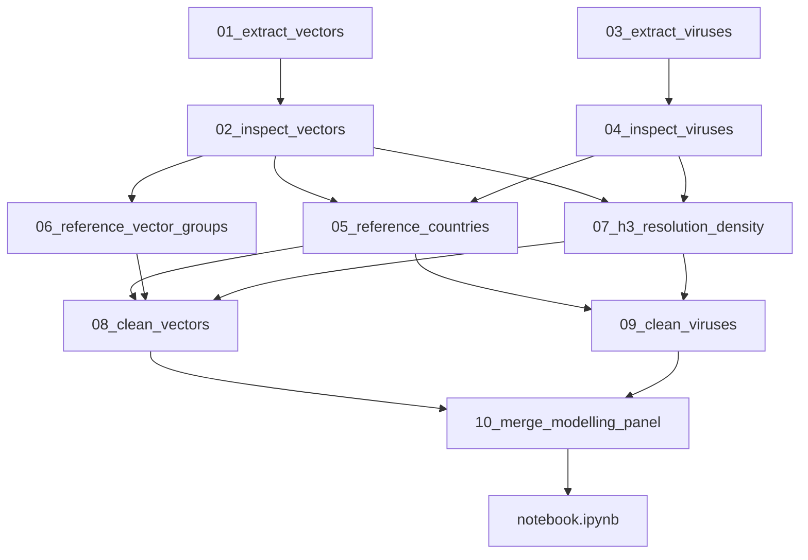

# Reference data and modelling-panel pipeline

Decision record for **reference / master data**, how each side is **resolved** onto join keys, and the **merge** step that produces the final modelling panel used for analysis and training.

| Field | Value |
|-------|-------|
| Status | Pipeline through modelling panel Done (`03`–`10`); `H3_RESOLUTION=4`; interim + `data/03_processed/modelling_panel.parquet`; primary `notebook.ipynb` panel prep Done |
| Decision date | 2026-11 (initial pipeline); 2026-11 (multi-source virus extract + subnational centroid reference); 2026-11 (`H3_RESOLUTION=4`); 2026-11 (Path B lookup parity + virus spelling aliases); 2026-11 (virus ENA / ISO-week date parsing) |
| Spec order | `04` (after spatial-temporal matching strategy) |
| Depends on | [`specs/03-spatial-temporal-matching-strategy.md`](03-spatial-temporal-matching-strategy.md), [`specs/01-vector-dataset-selection.md`](01-vector-dataset-selection.md), [`specs/02-virus-dataset-selection.md`](02-virus-dataset-selection.md) |

## Locked pipeline decisions

| Decision | Choice |
|----------|--------|
| Geographic keys | Worldwide join keys allowed (H3 / ISO-2) |
| Tier 1 paths | Exact / backfilled GPS **or** curated subnational / NUTS3 centroids → `(lat, lon)` → `h3_cell` (see spec `03`) |
| Training filter | A unit enters the **training** panel only if **VectorNet has coverage** in that unit; virus-only units may appear in descriptive EDA, not as supervised rows that imply vector context |
| Temporal grain | **`year` × `month`** |
| H3 resolution | **`4`** — chosen in `07_h3_resolution_density.ipynb`; constant `vector_guard.resolve.H3_RESOLUTION` |
| Virus raw extract | Multi-source unified `virus_detections.tsv` (ENA `sequence` + `read_run`/`sample`, BV-BRC, Pathoplexus, EMPRES-i, ECDC) — contract in [`specs/02`](02-virus-dataset-selection.md) |
| Pipeline scope | Virus extract + reference + H3 + clean + merge (`03`–`10`); modelling panel at `data/03_processed/` |

Join geometry and tier rules remain defined in [`specs/03-spatial-temporal-matching-strategy.md`](03-spatial-temporal-matching-strategy.md). This spec owns **artifacts, storage, notebook ownership, resolve rules, and the merge contract**.

## Data ladder

```text
data/
  01_raw/        # extracts only (gitignored); notebooks 01, 03
  external/      # committed master/lookup tables; notebooks 05, 06
  02_interim/    # normalized vector / virus row tables; notebooks 08, 09
  03_processed/  # modelling panel + merge manifest; notebook 10
```

| Layer | Contents | Commit? |
|-------|----------|---------|
| `01_raw/` | VectorNet DwC-A; multi-source `virus_detections.tsv` (+ `manifest.json`) | No (re-fetch documented in README) |
| `external/` | Countries, subnational centroids, vector taxon → group maps (small) | Yes |
| `02_interim/` | Per-side normalized detections | Usually no (rebuildable) |
| `03_processed/` | Aggregated modelling panel | Prefer commit if small; else document rebuild |

## What counts as reference data

**Uber H3 is not a downloaded master table.** Cell IDs are computed from `(lat, lon)` with the `h3` library at a fixed resolution. Do not store a worldwide H3 geometry dump for the join.

**ISO-2 countries, subnational / NUTS3 centroid lookups, name aliases, and vector_group maps are reference data** and live under `data/external/`.

| Artifact | Nature | Path | How generated | Used to resolve |
|----------|--------|------|---------------|-----------------|
| Countries + aliases + scope flags | Static reference CSV | `data/external/countries.csv` | Curated from ISO 3166-1 + virus / VectorNet name aliases observed in EDA | Virus `country` → `country_iso2`; validate VectorNet ISO-2; QA / scope flags |
| Subnational / NUTS3 centroids | Static reference CSV | `data/external/subnational_locations.csv` (~7.8k rows incl. virus spelling aliases) | Distinct virus region strings + European NUTS3/NE admin1 centroids + original spelling aliases | `(country_iso2, subnational_region \| nuts_id)` → centroid `(lat, lon)` → Tier 1 H3 |
| Pathogen ↔ `vector_group` | Project config (code) | [`src/vector_guard/data.py`](../src/vector_guard/data.py) `VIRUS_VECTOR_TAXON_MAP`; optional mirror `data/external/pathogen_vector_group.csv` | From [`specs/02-virus-dataset-selection.md`](02-virus-dataset-selection.md) | Tag virus rows; ecological join filter |
| Vector taxon → `vector_group` | Static reference CSV | `data/external/vector_taxon_groups.csv` | Curated from VectorNet `scientificName` inventory (EDA) | Tag VectorNet rows before aggregate / join |
| H3 resolution choice | Decision + code constant | This spec + `vector_guard.resolve.H3_RESOLUTION` (`4`) | Density-check notebook `07_h3_resolution_density.ipynb` | `lat/lon` → `h3_cell` |
| Modelling panel schema | Output contract | `data/03_processed/modelling_panel.*` | Merge notebook `notebooks/01_sources/10_merge_modelling_panel.ipynb` | Primary EDA / `notebook.ipynb` / `train.py` |

**Out of reference scope (v1):** full NUTS polygon geometry dumps; on-the-fly geocoders for unmatched free-text; committing raw extracts. NUTS **centroids** (and equivalent admin centroids) **are** in scope via `subnational_locations.csv`.

### `countries.csv` — generation rules

Columns:

| Column | Meaning |
|--------|---------|
| `iso2` | ISO 3166-1 alpha-2 code |
| `name` | Canonical English short name |
| `name_aliases` | Pipe- or semicolon-separated alternate spellings seen in virus feeds / VectorNet (e.g. `Czech Republic` / `Czechia`, `Russia` / `Russian Federation`) |
| `in_vectornet_scope` | Boolean / `0|1` — country appears (or is expected) in VectorNet Europe / Mediterranean coverage; used for QA and optional filters, **not** as the sole training gate |
| `europe_med` | Boolean / `0|1` — Europe / Mediterranean basin flag for descriptive splits (replaces hardcoded notebook sets) |

Generation process (notebook `notebooks/01_sources/05_reference_countries.ipynb`):

1. Start from a complete ISO 3166-1 alpha-2 list (library or authoritative public table).
2. Add aliases from unmatched virus `country` tokens (after stripping `Country: region…`) found across all multi-source feeds (ENA, BV-BRC, Pathoplexus, EMPRES-i, ECDC).
3. Mark `in_vectornet_scope` / `europe_med` from VectorNet country inventory (`02_inspect_vectors`) plus the known VectorNet geographic remit.
4. Write `data/external/countries.csv` and note row count / alias coverage in a short cell or sidecar note (optional `manifest` fields later).

### `subnational_locations.csv` — generation rules

Columns:

| Column | Meaning |
|--------|---------|
| `country_iso2` | ISO 3166-1 alpha-2 of the parent country |
| `region_key` | Normalized match key: lowercased / trimmed region string **or** NUTS/GAUL code (e.g. `emilia-romagna`, `iti43`) |
| `region_type` | One of `admin1`, `admin2`, `nuts3`, `locality` |
| `canonical_name` | Human-readable name for QA / docs |
| `lat` | Representative centroid latitude (WGS84) |
| `lon` | Representative centroid longitude (WGS84) |
| `source_authority` | Provenance of the centroid, e.g. `NUTS_2024`, `GADM`, `GeoNames` |

Generation process (same notebook family as countries — `notebooks/01_sources/05_reference_countries.ipynb`, with a dedicated section or follow-on cells for subnational rows):

1. Inventory distinct `(country, subnational_region)` / `nuts_id` values from the virus raw extract (ENA-style `Country: region`, Pathoplexus `division`, BV-BRC place strings, ECDC NUTS3 codes) and optionally VectorNet `higherGeographyID` for Europe consistency.
2. Normalize to `region_key` under a documented rule (casefold, strip punctuation, map common aliases).
3. Resolve each key to a trusted centroid from NUTS (Europe), GADM admin1/admin2, or GeoNames—**only** when the administrative scale is comparable to H3 res 4–5 (~50–150 km). Skip or leave unmatched ambiguous micro-localities.
4. Write `data/external/subnational_locations.csv` (committed). When a free-text region resolves via a secondary candidate, also persist the **original** normalized virus spelling as an alias row (same centroid). Extend curated `REGION_ALIASES` for high-frequency VectorNet-scope misses. Unmatched virus region strings remain country-only until a curated row is added—**never** invent a centroid in `09_clean_viruses` without updating this file. Notebook `09` writes rebuildable `data/02_interim/virus_unmatched_regions.csv` (with `in_vectornet_scope`) to guide follow-up curation.

### `vector_taxon_groups.csv` — generation rules

Columns:

| Column | Meaning |
|--------|---------|
| `scientific_name` | Exact or normalized VectorNet `scientificName` string |
| `vector_group` | One of `mosquito`, `tick`, `biting_midge`, `sandfly` |
| `notes` | Optional (genus-level rule, uncertain taxa) |

Generation process (notebook `notebooks/01_sources/06_reference_vector_groups.ipynb`):

1. Inventory distinct `scientificName` values from VectorNet.
2. Map each name (or genus rule) into the four `vector_group` values used by the virus taxonomy table.
3. Leave unmapped taxa out of the ecological join (or flag for manual review); do not invent a fifth group for v1.
4. Write `data/external/vector_taxon_groups.csv`.

Pathogen → `vector_group` stays authoritative in `VIRUS_VECTOR_TAXON_MAP` / spec `02`. An optional CSV mirror is for transparency only and must not drift from the code map without an explicit update.

### H3 resolution — selection process (not a static dump)

Notebook `07_h3_resolution_density.ipynb` chooses one integer resolution and records it; it does **not** ship a global H3 cell list.

**Candidates:** start with resolutions **4 and 5** (indicative ~50–150 km edge scale per spec `03`); optionally probe one coarser/finer neighbor if metrics are ambiguous.

**Metrics to compare** (report **twice** where noted: `exact_coords` only, and `exact_coords + subnational_centroid`):

| Metric | Intent |
|--------|--------|
| Share of detections assignable to an H3 cell | Tier 1 eligibility (exact-only vs exact+centroid) |
| Cells with ≥1 VectorNet detection | Vector coverage density |
| Cells with ≥1 virus detection among Tier 1-eligible rows | Virus Tier 1 density (exact-only vs exact+centroid) |
| Share of virus Tier 1 rows whose H3 cell also has VectorNet in the same `year`×`month`×`vector_group` | Empty-join / co-occurrence pressure under each geo mode |
| Median detections per occupied cell | Over-fragmentation vs lumping |
| Mix of `geo_precision` among Tier 1 virus rows | Transparency on how much Tier 1 relies on centroids |

**Selection rule:** pick the finest resolution that still yields a usable Tier 1 co-occurrence rate and stable cell occupancy for modelling under the **exact + centroid** mode (the locked production path); also document exact-only metrics as a sensitivity check. Prefer interpretability over micro-cells with almost no overlaps. Record the chosen `H3_RESOLUTION` in this spec, in `vector_guard.resolve.H3_RESOLUTION`, and in the merge panel manifest.

**Decision (2026-11):** `H3_RESOLUTION = 4`. Under `exact_plus_centroid`, res 4 retains ~3× the hex×month×`vector_group` co-occurring virus rows of res 5 (~128 vs ~45) with stable median occupancy (~3–4 virus detections per occupied cell). Res 5 over-fragments relative to VectorNet coverage. Res 3 was probed as a coarser neighbor (~335 co-occurring rows) but is outside the primary candidate band; production stays at 4. Absolute co-occurrence remains sparse (VectorNet Europe/Med vs worldwide virus extract); the VectorNet-coverage training filter still applies at merge. Details: [`notebooks/01_sources/07_h3_resolution_density.ipynb`](../notebooks/01_sources/07_h3_resolution_density.ipynb).

**Path B lookup parity (locked):** Runtime `lookup_subnational_centroid` in [`src/vector_guard/resolve.py`](../src/vector_guard/resolve.py) uses the same trailing-first `region_candidate_keys` / `strip_admin_suffix` logic as notebook `05` (comma / ` - ` / `;` segments). Notebook `05` persists original virus spelling aliases into `subnational_locations.csv` and curated `REGION_ALIASES` for high-frequency VectorNet-scope misses. Unmatched keys go to rebuildable `data/02_interim/virus_unmatched_regions.csv` for follow-up curation—never invent centroids in `09_clean_viruses`.

**Virus date formats (locked):** `parse_collection_sort_key` / `parse_year_month_virus` in [`src/vector_guard/virus_extract.py`](../src/vector_guard/virus_extract.py) and [`src/vector_guard/resolve.py`](../src/vector_guard/resolve.py) accept ISO `YYYY-MM(-DD)`, ENA `dd-Mon-yyyy` / `Mon-yyyy`, and ISO week `YYYY-Www` (Monday of that week → calendar month). Bare years lack month and stay panel-excluded (grain remains `year × month`; season fallback deferred).

**Locate a cell on a map:** paste any panel / interim `h3_cell` ID into the [H3 Viewer](https://clupasq.github.io/h3-viewer/) to inspect its hexagon on a basemap.

## Pipeline ownership



| Step | Notebook | Writes | Reads |
|------|----------|--------|-------|
| Extract vectors | `notebooks/01_sources/01_extract_vectors.ipynb` | `data/01_raw/vector/` | VectorNet DwC-A URL |
| Extract viruses | `notebooks/01_sources/03_extract_viruses.ipynb` | `data/01_raw/virus/virus_detections.tsv` + `manifest.json` | Multi-source feeds — contract in [`specs/02`](02-virus-dataset-selection.md) |
| Source inspect vectors | `notebooks/01_sources/02_inspect_vectors.ipynb` | Insights / cleaning rules only | raw vectors |
| Source inspect viruses | `notebooks/01_sources/04_inspect_viruses.ipynb` | Insights / cleaning rules only | raw viruses |
| Country + subnational reference | `notebooks/01_sources/05_reference_countries.ipynb` | `data/external/countries.csv`, `data/external/subnational_locations.csv` | ISO list + alias / region / NUTS needs from multi-source extract; unmatched list from `09` |
| Vector group map | `notebooks/01_sources/06_reference_vector_groups.ipynb` | `data/external/vector_taxon_groups.csv` | VectorNet `scientificName` inventory |
| H3 density check | `07_h3_resolution_density.ipynb` | Decision in this spec + `vector_guard.resolve.H3_RESOLUTION`; no world H3 dump | lat/lon from both sides under exact-only and exact+centroid modes |
| Clean vectors | `notebooks/01_sources/08_clean_vectors.ipynb` | `data/02_interim/vectors_normalized.parquet` | raw + `countries` + optional `subnational_locations` + `vector_taxon_groups` + `H3_RESOLUTION` |
| Clean viruses | `notebooks/01_sources/09_clean_viruses.ipynb` | `data/02_interim/viruses_normalized.parquet`; `data/02_interim/virus_unmatched_regions.csv` (`in_vectornet_scope` flag) | raw + `countries` + `subnational_locations` + taxon map + `H3_RESOLUTION` |
| **Merge panel** | `notebooks/01_sources/10_merge_modelling_panel.ipynb` | `data/03_processed/modelling_panel.parquet` + `modelling_panel_manifest.json` | both interim tables |
| Primary EDA + models | `notebook.ipynb` | Panel prep Done; model training next (see ROADMAP) | modelling panel |

Source inspect notebooks (`02`, `04` under `notebooks/01_sources/`) diagnose quality and relevance; they do **not** own the final modelling table and are **not** the project EDA deliverable. Cleaning notebooks apply documented rules; the merge notebook owns the panel contract.

Virus raw extract schema, feeds, and taxonomy: [`specs/02-virus-dataset-selection.md`](02-virus-dataset-selection.md) (notebook `03` implements that contract).

## Resolve rules (before merge)

Apply these when building interim normalized tables. **Join principles** (Path A / B, Tier 1 vs 2, guardrails, temporal grain, ecological link) are defined in [`specs/03-spatial-temporal-matching-strategy.md`](03-spatial-temporal-matching-strategy.md). This section is the implementer contract only.

### Country → `country_iso2`

| Side | Rule |
|------|------|
| VectorNet | Prefer published `countryCode` when present; else derive ISO-2 from the first two characters of `higherGeographyID` (as in `02_inspect_vectors`). Validate against `countries.csv`. |
| Virus (all sources) | Parse the country token before `:` in `country` when ENA-style (e.g. `Italy: Tuscany` → `Italy`). Map via `name` / `name_aliases` → `iso2`. Apply the same alias table to BV-BRC / Pathoplexus / EMPRES-i / ECDC country fields. |
| Unmapped | Flag; exclude from modelling keys until resolved (do not invent ISO codes). |

### Coordinates → `(lat, lon)` → `h3_cell` (priority locked)

Implements Path A → Path B → Tier 2 from spec `03`. Resolve virus (and, if needed, vector) coordinates in this order before assigning H3:

| Priority | Rule | Resulting `geo_precision` |
|----------|------|---------------------------|
| 1 | Use source exact GPS when `lat`/`lon` valid (`coord_source` in `{exact_gps, sample_backfill}` for viruses; VectorNet decimal coords) | `exact_coords` |
| 2 | Prefer any richer exact coords already merged across INSDC sources in the raw extract (accession / sample backfill) — still treated as exact | `exact_coords` |
| 3 | Match `(country_iso2, normalized subnational_region)` or `nuts_id` to `data/external/subnational_locations.csv` via `region_candidate_keys` (trailing-first admin tokens after `,` / ` - ` / `;`, plus `strip_admin_suffix`); use table `lat`/`lon` | `subnational_centroid` |
| 4 | No match → leave coords null | `country_only` |

Then:

| Rule | Detail |
|------|--------|
| Valid resolved lat/lon | Assign `h3_cell` at `H3_RESOLUTION` → **Tier 1** |
| Missing / invalid coords after the ladder | Leave `h3_cell` null → **Tier 2** (`country_iso2`) |
| Unmatched region strings | Persist to `data/02_interim/virus_unmatched_regions.csv` for notebook `05` curation; do not geocode inside `09_clean_viruses` (guardrails in spec `03`) |

### Time → `year`, `month`

Temporal grain principle (`year` × `month` locked): [`specs/03`](03-spatial-temporal-matching-strategy.md#temporal-alignment).

| Rule | Detail |
|------|--------|
| Grain | Modelling keys use **`year` × `month`**. |
| Required | Rows without a usable `year` and `month` are excluded from the modelling panel. |
| VectorNet intervals | `eventDate` often has start/end; use a **documented, consistent** rule (prefer interval midpoint’s year-month, or start year-month if midpoint is undefined) and record it in `08_clean_vectors`. |
| Virus (all sources) | Parse `collection_date` (or outbreak observation / reporting date) via `parse_year_month_virus` → `parse_collection_sort_key`. |
| Virus accepted forms | ISO `YYYY-MM` / `YYYY-MM-DD`; ENA / GenBank `dd-Mon-yyyy` and `Mon-yyyy`; ISO week `YYYY-Www` mapped to the Monday of that week’s calendar month. |
| Virus excluded | Year-only (`YYYY`), empty / unparseable, and other strings without a recoverable calendar month — drop from the panel (may remain in descriptive EDA). Do **not** invent a month for bare years. |

### Ecology → `vector_group`

Ecological join principle (same `vector_group` only): [`specs/03`](03-spatial-temporal-matching-strategy.md#ecological-taxonomic-link).

| Side | Rule |
|------|------|
| Viruses | From `VIRUS_VECTOR_TAXON_MAP` / extract tags (`pathogen_name`, `vector_group`). |
| Vectors | Join / map `scientificName` via `vector_taxon_groups.csv`. |
| Merge | Aggregate and join **only within the same** `vector_group`. |

## Merge step — modelling panel

**Goal:** one final dataset for model analysis and generation (`notebook.ipynb`, later `train.py`).

### Unit definition

Panel rows are **spatial–temporal units**, not raw detection rows. Path A / B and tier principles: [`specs/03`](03-spatial-temporal-matching-strategy.md).

| Tier | Key | When |
|------|-----|------|
| Tier 1 | `(h3_cell, year, month, vector_group)` | Vector side has usable H3; virus features/labels attach when virus rows share that cell-window |
| Tier 2 | `(country_iso2, year, month, vector_group)` | Fallback when H3 cannot be used for that unit |

Prefer Tier 1 when the vector side supports it. Country-only virus rows contribute at **Tier 2** only.

### Training filter

- **Include** units with **VectorNet coverage** (vector feature present for that key).
- Virus detection in the unit-window becomes the **label / target** (e.g. binary any detection in the merged feeds and/or count). Optionally retain source-mix summaries (sequence vs outbreak) as features or QA columns.
- Virus-only units (no VectorNet in that key) may be exported for descriptive EDA but are **excluded from the supervised training panel**.
- Caveats from spec `03` still apply: virus zero ≠ true absence; no VectorNet traps ≠ true vector absence; sequences ≠ clinical cases; centroid Tier 1 ≠ point GPS precision.

### Panel columns

Authoritative schema for `data/03_processed/modelling_panel.*` (column order as written by `notebooks/01_sources/10_merge_modelling_panel.ipynb`). This table is the single source of truth for field meanings; the merge notebook implements it.

| Column | Meaning |
|--------|---------|
| `spatial_tier` | `h3` (Tier 1) or `country` (Tier 2) |
| `h3_cell` | H3 cell ID when `spatial_tier == h3`; null on Tier 2 |
| `country_iso2` | ISO 3166-1 alpha-2; Tier 2 join key, and metadata on Tier 1 when known |
| `year` | Calendar year of the unit window |
| `month` | Calendar month (1–12) of the unit window |
| `vector_group` | Ecological class: `mosquito`, `tick`, `biting_midge`, or `sandfly`. Part of the join key — vectors and viruses merge only within the same group |
| `vector_present` | Always `1` in this supervised panel (VectorNet-left join; virus-only units are excluded) |
| `vector_detection_count` | Number of VectorNet records in the unit (`count` of `record_id`) |
| `individual_count_sum` | Sum of parsed VectorNet `individualCount` over those records (unparseable / missing contribute 0 to the sum) |
| `individual_count_mean` | Mean of parsed `individualCount` over records with a parseable value |
| `virus_detected` | Binary label: `1` if `virus_detection_count > 0`, else `0`. Zero means no reported detection in the merged virus feeds for that unit-window — **not** proven absence |
| `virus_detection_count` | Number of virus records in the unit (`count` of `record_id`); filled with `0` when no virus rows match |
| `virus_source_n_sequence` | Count of virus rows whose `source` is an INSDC / sequence feed (`ena_sequence`, `ena_read_run`, `bvbrc`, `pathoplexus`); `0` when none |
| `virus_source_n_outbreak` | Count of virus rows whose `source` is an outbreak feed (`empres_i`, `ecdc_atlas`); `0` when none |
| `share_virus_exact_coords` | Among virus rows in the unit, fraction with `geo_precision == exact_coords`. Set on Tier 1 positives; `NA` on Tier 2 or when no virus rows |
| `share_virus_subnational_centroid` | Among virus rows in the unit, fraction with `geo_precision == subnational_centroid`. Set on Tier 1 positives; `NA` on Tier 2 or when no virus rows |

### Outputs

| Path | Role |
|------|------|
| `data/03_processed/modelling_panel.parquet` (or `.csv`) | Modelling handoff table |
| Merge summary / manifest fields | `H3_RESOLUTION`, row counts by `spatial_tier`, geo-precision mix, date range, training filter rules, source raw manifests’ SHA-256 when available |

Consumers: `notebook.ipynb` (EDA on the panel + model selection), `train.py` (load panel or rebuild via the same pipeline).

## Non-goals (remaining pipeline)

- Changing `H3_RESOLUTION` without re-running notebook `07` and rebuilding interim + panel
- Shipping full NUTS polygon dumps or calling live geocoders for unmatched free-text
- Committing `data/01_raw/` extracts
- Defining the final ML feature set beyond the panel contract above

## Status

Pipeline through modelling panel is complete (`03`–`10`; `H3_RESOLUTION=4`). Panel prep in `notebook.ipynb` is Done; further EDA, models, and `train.py` are tracked in [`ROADMAP.md`](../ROADMAP.md).

## Related project files

| Path | Role |
|------|------|
| [`specs/03-spatial-temporal-matching-strategy.md`](03-spatial-temporal-matching-strategy.md) | Tier geometry, Path A/B into H3, ecological link principles |
| [`specs/01-vector-dataset-selection.md`](01-vector-dataset-selection.md) | VectorNet source |
| [`specs/02-virus-dataset-selection.md`](02-virus-dataset-selection.md) | Multi-source virus feeds, unified schema, pathogen ↔ vector_group |
| [`README.md`](../README.md) | Data ladder and intended approach |
| [`ROADMAP.md`](../ROADMAP.md) | Build status (data foundation Done; EDA / models next) |
